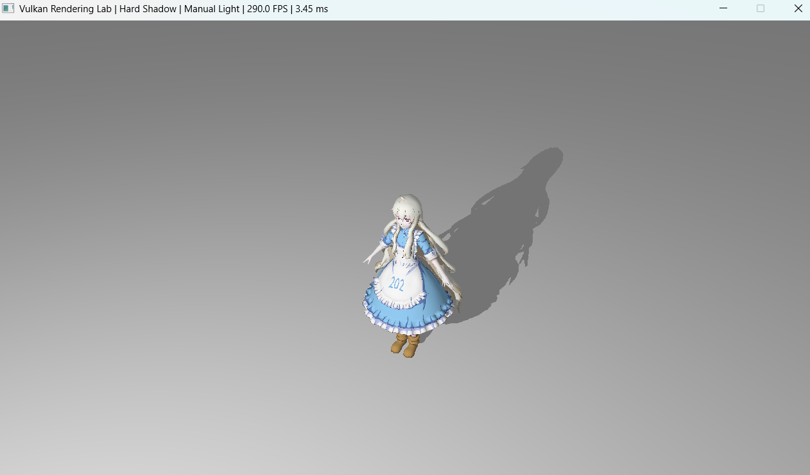
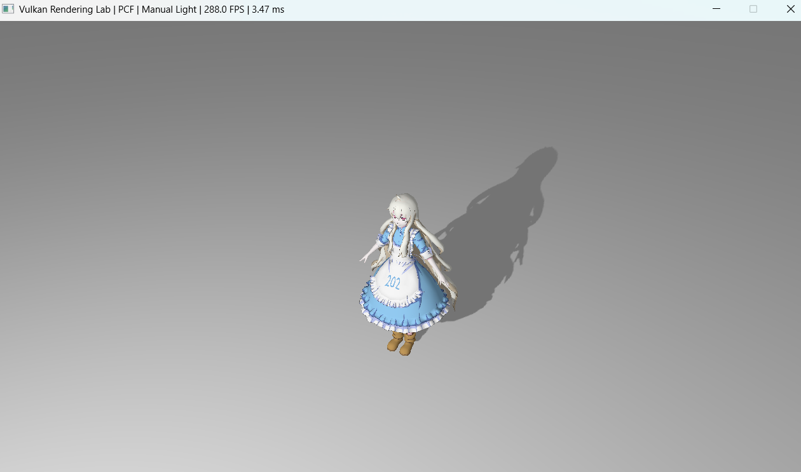
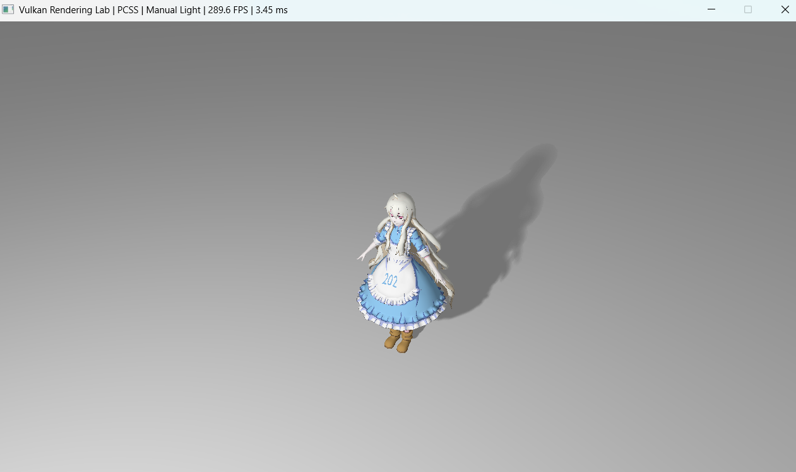

# Vulkan Rendering Lab

A real-time rendering project built from scratch with C++ and Vulkan, focused on graphics pipeline construction, real-time shadow techniques, dynamic lighting, and interactive rendering controls.

This project was developed as an independent rendering study after completing the GAMES202: High-Quality Real-Time Rendering course. The course provided the theoretical foundation for several rendering techniques explored in this project, particularly shadow mapping, Percentage-Closer Filtering (PCF), and Percentage-Closer Soft Shadows (PCSS).

Rather than directly reproducing the original WebGL-based coursework, I implemented a custom rendering framework using C++ and Vulkan to explore how these techniques can be integrated into a lower-level graphics API and a modular real-time rendering architecture.

The project implements a custom Vulkan rendering pipeline for loading and rendering textured OBJ models, generating real-time shadow maps, comparing multiple shadow filtering techniques, and controlling dynamic lighting and the camera at runtime.

## Features

### Vulkan Rendering Pipeline

The renderer implements the core Vulkan rendering workflow, including:

- Vulkan instance and device initialization
- Physical and logical device selection
- Graphics and presentation queues
- Swapchain creation
- Render passes and framebuffers
- Graphics pipelines
- Vertex and index buffers
- Uniform buffers
- Descriptor sets
- Texture images and samplers
- Command buffers
- Frame synchronization

The rendering architecture separates major Vulkan components into dedicated classes to keep the codebase modular and easier to maintain.

### OBJ Model Loading

The project supports loading OBJ models with multiple materials and submeshes.

Implemented features include:

- OBJ geometry loading
- Vertex positions
- Vertex normals
- Texture coordinates
- Material parsing
- Diffuse textures
- Multiple submeshes
- Material-based draw calls

The demo scene contains a textured character model and a floor mesh used for lighting and shadow visualization.

### Real-Time Shadow Mapping

A dedicated shadow pass renders scene depth from the active shadow-casting light.

The generated shadow map is sampled during the main camera pass to calculate real-time shadows.

The renderer supports multiple shadow techniques that can be switched at runtime.

#### Hard Shadows

Standard shadow map depth comparison.

This mode provides sharp shadow boundaries and serves as the baseline implementation.

#### Percentage-Closer Filtering (PCF)

PCF performs multiple depth comparisons around the current shadow coordinate and averages the results.

This produces smoother shadow edges compared with standard hard shadows.

#### Percentage-Closer Soft Shadows (PCSS)

PCSS implements variable-width soft shadows based on the distance between the receiver and detected blockers.

The implementation consists of:

1. Blocker search
2. Average blocker depth estimation
3. Penumbra size calculation
4. Variable-radius shadow filtering

Perspective shadow depth is linearized before calculating the penumbra ratio.

This allows shadows to remain relatively sharp near contact areas while becoming softer as the receiver moves farther from the blocker.

### Orbiting Dynamic Light


The colored local light automatically orbits around the model along the Y axis. Its position is updated at runtime and used to calculate both direct lighting and the shadow camera transformation.

This allows the illumination and PCSS shadow projection to move together in real time.

A colored local light automatically moves around the model by updating its position around the Y axis.

The light position is calculated using:

```text
x = cos(angle) * radius
z = sin(angle) * radius
```

The resulting position is used for both lighting calculations and the shadow camera view transformation.

This allows the light and its shadow projection to move together around the scene.

### Dynamic Shadow Camera

The shadow camera follows the currently active shadow-casting light.

When the dynamic light is enabled:

```text
Orbiting Light
      |
      v
Shadow View Matrix
      |
      v
Shadow Pass
      |
      v
Dynamic Shadow Map
```

When the dynamic light is disabled, the shadow camera switches to the fixed front light.

The renderer therefore maintains a single shadow pass while supporting both fixed and dynamic shadow behavior.

This design avoids the additional cost and complexity of rendering omnidirectional point-light shadows with a depth cubemap.

### Interactive Light Controls

The dynamic light can be controlled at runtime.

Supported features include:

- Enable or disable the dynamic light
- Pause and resume automatic light movement
- Switch between automatic orbit and manual control
- Move the light manually along the X, Y, and Z axes

The shadow projection updates together with the active shadow-casting light.

### Orbit Camera

The camera can be controlled interactively.

Features include:

- Mouse orbit
- Camera zoom
- Camera reset
- Configurable yaw
- Configurable pitch
- Configurable camera distance

The camera always looks toward the model while moving around the target position.

### Shadow Map Debug View

The renderer includes a shadow map visualization mode.

The depth texture generated during the shadow pass can be displayed directly on screen.

This mode is useful for debugging:

- Shadow camera coverage
- Depth rendering
- Light projection
- Shadow map artifacts

### Runtime Shadow Switching

Shadow techniques can be switched while the application is running.

```text
1 - Hard Shadow
2 - PCF
3 - PCSS
4 - Shadow Map Debug View
```

This makes it possible to directly compare the visual differences between each shadow technique.

### Runtime Performance Display

The application window displays real-time performance information.

Example:

```text
Vulkan Rendering Lab | PCSS | Orbit Light | 286 FPS | 3.47 ms
```

Displayed information includes:

- Current shadow technique
- Current light control mode
- Frames per second
- Frame time

## Controls

| Input | Action |
|---|---|
| `1` | Hard Shadow |
| `2` | PCF |
| `3` | PCSS |
| `4` | Shadow Map Debug View |
| `P` | Enable / Disable Dynamic Light |
| `Space` | Pause / Resume Light Animation |
| `M` | Switch Between Orbit and Manual Light Control |
| `J / L` | Move Manual Light Along X Axis |
| `I / K` | Move Manual Light Along Z Axis |
| `U / O` | Move Manual Light Along Y Axis |
| `Left Mouse Drag` | Orbit Camera |
| `Mouse Wheel` | Camera Zoom |
| `R` | Reset Camera |
| `Esc` | Exit |

## Rendering Pipeline

The renderer uses two main rendering passes.

```text
Scene Geometry
      |
      v
Shadow Pass
      |
      v
Shadow Depth Image
      |
      v
Main Camera Pass
      |
      +----------------------+
      |                      |
      v                      v
Material Texture        Shadow Map
      |                      |
      +----------+-----------+
                 |
                 v
        Lighting Calculation
                 |
                 v
           Final Image
```

### Shadow Pass

The shadow pass:

1. Renders scene geometry from the active light position
2. Writes depth values into the shadow depth image
3. Uses the light view-projection matrix stored in the uniform buffer

### Main Camera Pass

The main camera pass:

1. Renders the scene from the camera
2. Samples material textures
3. Calculates fixed and dynamic lighting
4. Samples the shadow map
5. Applies Hard Shadow, PCF, or PCSS filtering
6. Produces the final image

## Project Structure

```text
VulkanRenderingLab/
|
+-- assets/
|   |
|   +-- models/
|       |
|       +-- mary/
|       |
|       +-- floor/
|
+-- shaders/
|   |
|   +-- triangle.vert
|   +-- triangle.frag
|   +-- shadow.vert
|   +-- shadow.frag
|
+-- src/
|   |
|   +-- Core/
|   |   |
|   |   +-- VulkanContext
|   |   +-- Window
|   |
|   +-- Renderer/
|   |   |
|   |   +-- Renderer
|   |   +-- GraphicsPipeline
|   |   +-- RenderPass
|   |   +-- Framebuffer
|   |   +-- CommandManager
|   |   +-- DescriptorManager
|   |
|   +-- Shadow/
|   |   |
|   |   +-- ShadowPipeline
|   |   +-- ShadowRenderPass
|   |   +-- ShadowFramebuffer
|   |
|   +-- Resources/
|   |
|   +-- main.cpp
|
+-- CMakeLists.txt
|
+-- README.md
```

> The exact directory structure may vary as the renderer continues to be organized and refactored.

## Technical Highlights

### Single Dynamic Shadow Pass

The renderer uses one shadow map and dynamically changes the shadow camera based on the active shadow-casting light.

This keeps the rendering architecture relatively lightweight while still allowing dynamic shadows.

### Shared Uniform Buffer

The shadow pass and main camera pass share dynamic rendering data through a uniform buffer.

The buffer stores:

- Model matrix
- Camera view matrix
- Camera projection matrix
- Light view-projection matrix
- Shadow settings
- Dynamic light position
- Dynamic light color and intensity

Updating the uniform buffer allows the dynamic light and shadow transformation to change without rebuilding the graphics pipeline.

### Material-Based Submesh Rendering

Loaded OBJ models are divided into submeshes based on material assignments.

Each submesh stores:

- Material index
- First index
- Index count

This allows textured and non-textured parts of the model to be rendered correctly.

### Perspective Shadow Mapping

The dynamic local light uses a perspective projection for shadow rendering.

Unlike directional-light shadow mapping with orthographic projection, perspective shadow depth is non-linear.

The PCSS implementation therefore linearizes shadow depth before estimating blocker distance and penumbra size.

## Performance

The project was tested using a Release build.

Observed performance in the current demo scene:

```text
Frame Rate: approximately 284 - 288 FPS
Frame Time: approximately 3.46 - 3.48 ms
```

The current scene is intentionally lightweight and is primarily designed to demonstrate rendering architecture, dynamic lighting, and shadow algorithms rather than serve as a large-scale performance benchmark.

## Technologies

- C++17
- Vulkan
- GLSL
- GLFW
- GLM
- CMake
- TinyObjLoader
- stb_image

## From Coursework to Independent Implementation

One of the main goals of this project was to move beyond implementing rendering algorithms inside an existing educational framework.

The original GAMES202 coursework provided implementations and experiments primarily within course-specific WebGL and C++ frameworks. For this project, I independently built the rendering infrastructure required to integrate similar concepts into Vulkan.

This required solving additional engineering problems that were separate from the rendering algorithms themselves:

- Creating and managing Vulkan render passes
- Building graphics and shadow pipelines
- Managing GPU buffers and descriptor resources
- Recording multi-pass command buffers
- Implementing OBJ model and material loading
- Supporting multiple submeshes
- Creating and sampling shadow depth images
- Sharing dynamic light transformations through uniform buffers
- Designing interactive runtime controls
- Debugging Vulkan resource, shader, and pipeline integration issues

The resulting project combines the rendering theory studied through GAMES202 with practical low-level graphics programming and renderer architecture development.

## Future Improvements

Possible future extensions include:

- Omnidirectional point-light shadows using depth cubemaps
- Multiple shadow-casting lights
- Physically Based Rendering
- Normal mapping
- Additional model formats
- Improved GPU profiling
- Cascaded Shadow Maps
- Screen-space rendering effects
- Improved resource management
- More advanced synchronization and frame resource management

## Build

### Requirements

- Vulkan SDK
- CMake
- C++17 compatible compiler
- GLFW
- GLM

### Build Instructions

Clone the repository:

```bash
git clone <repository-url>
cd VulkanRenderingLab
```

Generate the project:

```bash
cmake -S . -B build
```

Build the Release configuration:

```bash
cmake --build build --config Release
```

Run the application on Windows:

```bash
.\build\Release\VulkanRenderingLab.exe
```

Rendering and graphics programming portfolio project focused on Vulkan, real-time lighting, and shadow algorithms.
