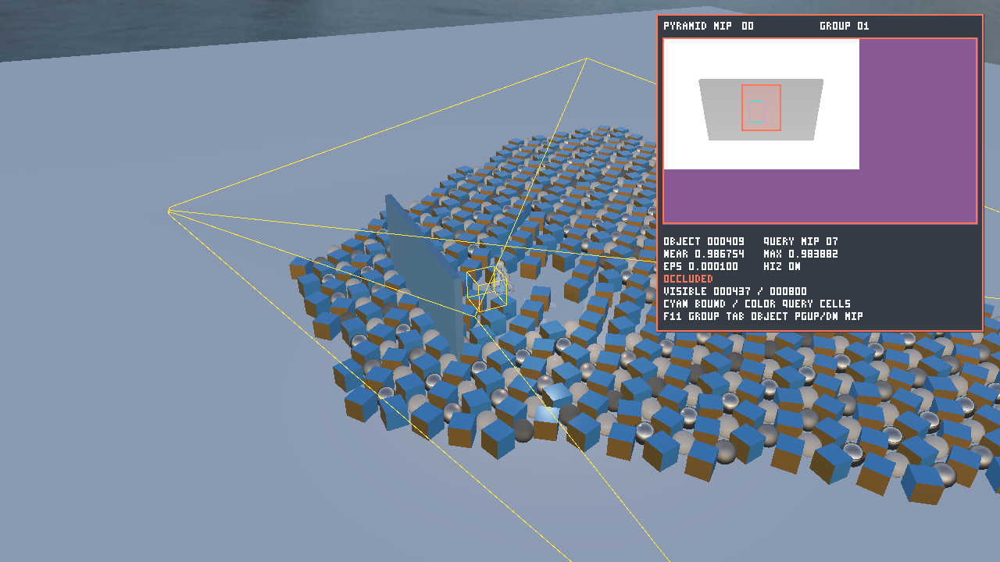
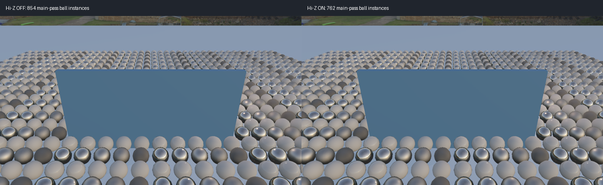
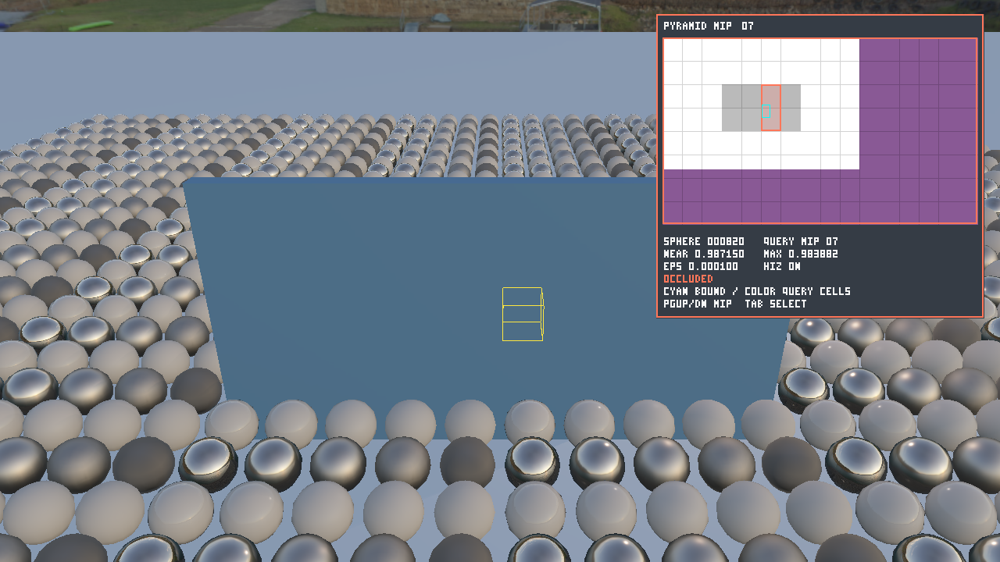
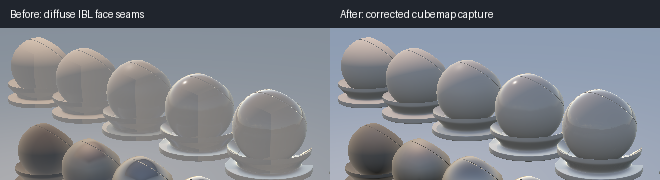
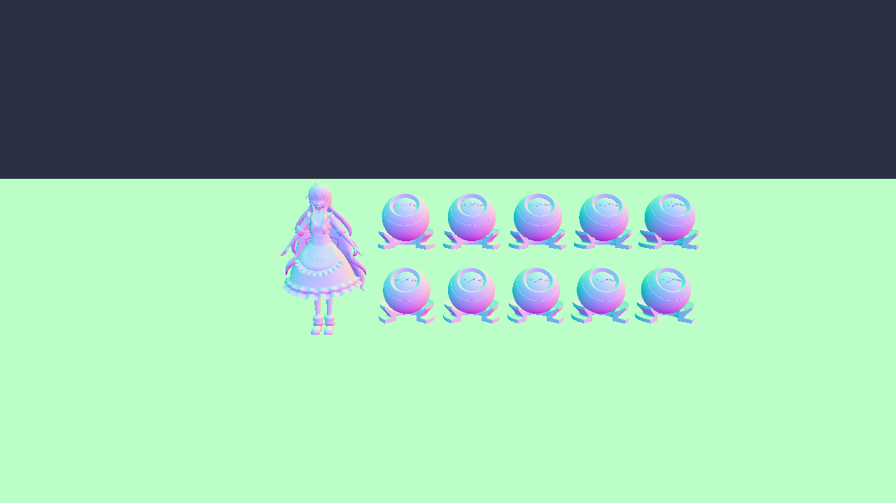
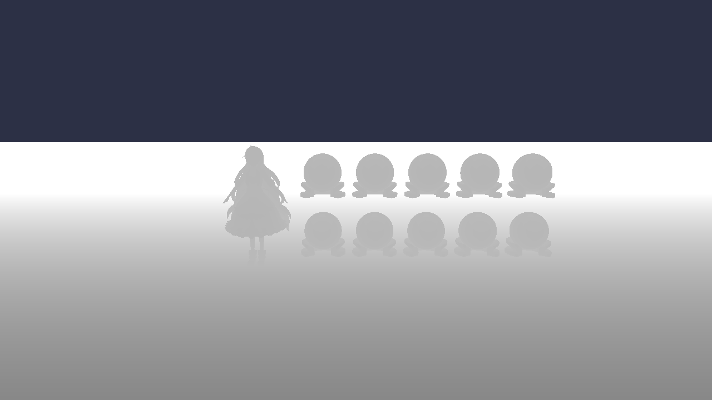
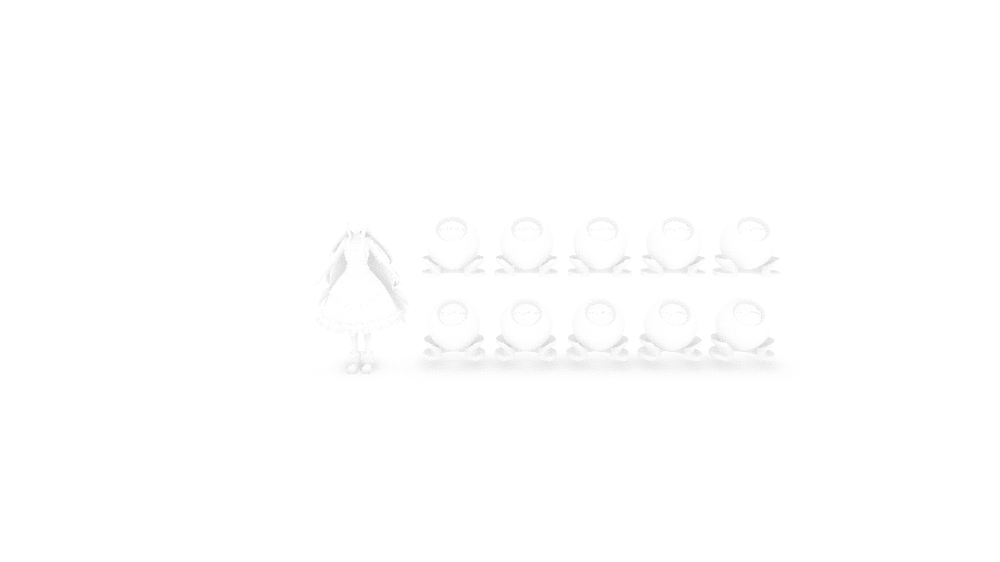
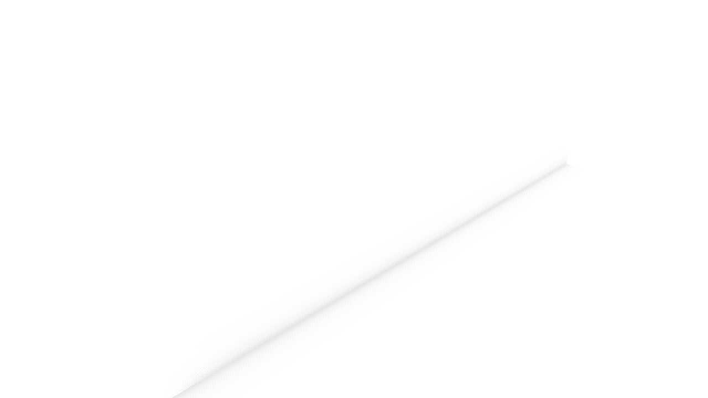
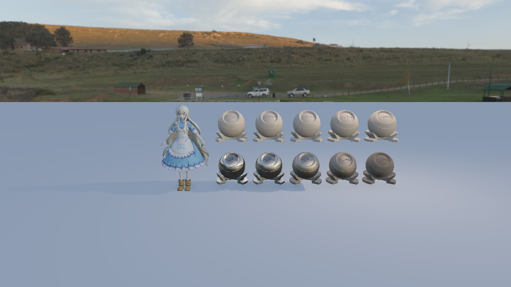
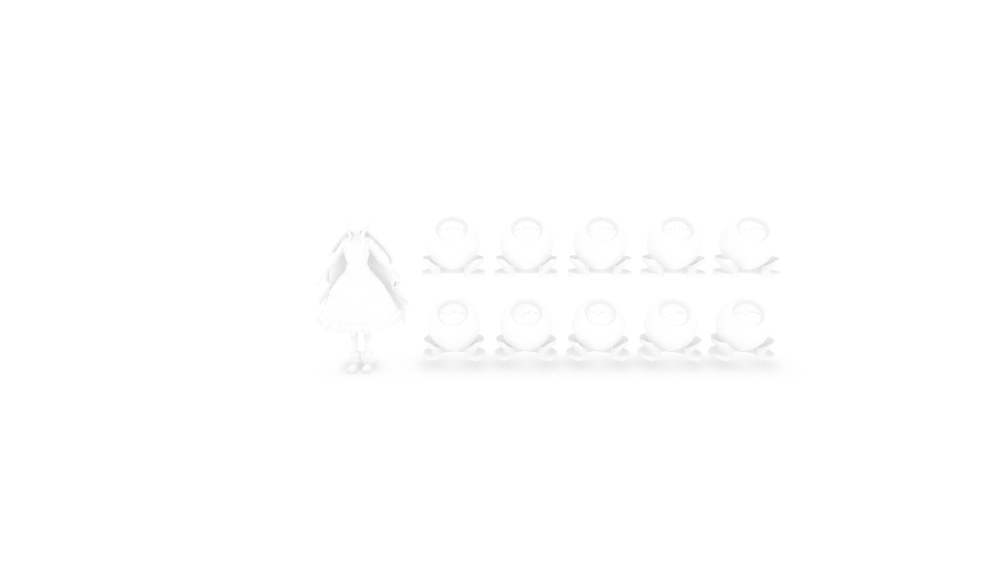

# Vulkan Rendering Lab

A modern real-time renderer built with **C++17** and **Vulkan**, featuring multi-pass rendering, real-time shadow mapping, Percentage-Closer Filtering (PCF), Percentage-Closer Soft Shadows (PCSS), GPU profiling, and benchmark-driven rendering optimization.

This project extends concepts studied in the **GAMES202: High-Quality Real-Time Rendering** course by implementing them within a custom Vulkan renderer instead of the original WebGL framework.

Rather than reproducing the original coursework, the project focuses on building a modular Vulkan renderer from scratch, integrating multiple shadow algorithms, profiling GPU execution using Vulkan Timestamp Queries, and evaluating rendering performance through benchmark-driven optimisation.

## Shared mesh instancing

The ten original material-lab objects now share one vertex/index mesh and use an
80-byte SSBO record per instance (transform + metallic/roughness/AO override).
Both main and shadow vertex shaders fetch binding 12 using `gl_InstanceIndex`.
The original model's two material ranges need two instanced draws per pass,
compared with twenty ball draws before. Character, floor and baked glTF geometry
use identity instance 0. The initial shared-mesh stage is now extended by GPU frustum culling and indirect
main-pass draws, described below. Shadow draws retain the full instance range.

A separate low-detail sphere field can exercise instance counts without repeating
the high-detail model's geometry:

```powershell
.\build\Release\VulkanRenderingLab.exe --stress-count 10000 --pitch 55 --paused
```

Stress mode supports 1..10000 instances and cannot be combined with `--scene`.
It uses a 153-vertex/672-index sphere (11,868 mesh bytes) plus 80 bytes per object.
It retains the existing light/shadow frustum; large-scene shadow coverage is limited.
Geometry storage and draw-call savings do not imply proportional GPU-time savings.

## GPU frustum culling and indirect rendering

A 64-thread compute shader tests conservative prototype bounding spheres against
the six Vulkan camera-frustum planes, compacts visible instance IDs using atomics,
and writes `VkDrawIndexedIndirectCommand.instanceCount` for each material range.
The main vertex shader remaps compact slots through the visible-ID buffer. CPU
camera-plane extraction is constant work; per-instance CPU tests occur only in
explicit verification mode. Rendering does not wait for a CPU-visible count to
choose its draw size. Character/floor/baked glTF draws retain the direct path;
each prototype has its own disjoint visible-ID partition and may have multiple
material ranges. Shadows deliberately draw every instance.

```powershell
.\build\Release\VulkanRenderingLab.exe --stress-count 10000 --camera-distance 8 --pitch 25 --paused
```

Press **C** to toggle frustum culling; the window title reports the most recently
completed frame's visible/total count. `--no-culling` runs GPU compaction in pass-through
mode; `--verify-culling` additionally reads back exact visible IDs for comparison
with an independent CPU frustum-test path. That mode is for correctness testing,
not performance measurement. Normal telemetry copies only indirect commands and small counter statistics.

The tested fixed stress view reduced main-pass ball instances from **10000 to 3016**
with **pixel-identical culling ON/OFF captures**; a camera shifted away produced
zero instances correctly. These are workload counts, not a GPU speedup claim.
GPU timestamps now include a Cull/Compact interval (reset, dispatch, dependencies
and diagnostic copy) as well as shadow and main passes. Hi-Z is available in the optional static-wall scene below. Transparent sorting,
async compute and a multi-frame output ring are not implemented.

The device selection requires a combined graphics+compute queue. Each indirect call
has drawCount=1 and firstInstance=0, avoiding optional multi-draw/nonzero indirect
first-instance feature requirements. Explicit transfer/compute/vertex/indirect/host
dependencies protect the outputs. Vulkan validation also prompted fixes to legacy
IBL push-constant stages, render-pass depth/external dependencies and per-image
present semaphores.

## Multiple prototypes and material ranges

```powershell
.\build\Release\VulkanRenderingLab.exe --mixed-scene --hiz-inspector --paused
```

This optional scene alternates spheres with rotating, blue/orange two-material
cubes. `--stress-count` is the **total** object count (default 1600, range 2..10000),
partitioned between the two prototypes. The existing character, floor and static
occluder wall remain. Add `--culling-observer` to inspect from the side.



**F11 / Shift+F11** select a group; **Tab / Shift+Tab** select an object within
it. `--inspect-group 1` starts on cubes. The inspector displays the selected
group's current GPU visible count and capacity; with the inspector off, the
window title reports both groups. The console prints per-group frustum and
occlusion counts. A fixed 1600-object view produced:

| Group | Total | Frustum survivors | Hi-Z rejected | Visible objects | Material draws |
|---|---:|---:|---:|---:|---:|
| Spheres | 800 | 427 | 46 | 381 | 1 |
| Cubes | 800 | 444 | 7 | 437 | 2 |

Both cube material draws consume the same 437 IDs, so the unique visible object
count is **818**, not the sum of all material command instance counts. Different
prototype bounds intentionally produce different rejection rates.

A 48-byte SSBO record per group defines its prototype sphere, source instance
range, visible-output base, indirect-command range and statistics index. One
64-thread compute kernel uses the dispatch Y dimension for groups and X for
instances. Each group's atomic counter reserves slots only inside its fixed
output partition. The vertex shader adds the group's visible base from material
push constants before remapping instance IDs. Commands retain firstInstance=0;
material descriptor binding and one indirect call per range remain explicit.
This extends GPU instance counts, not GPU-generated draw counts or bindless materials.

Layout construction rejects overlapping source ranges, inconsistent bounds and
oversized command templates. Material ranges can be interleaved in scene order;
an explicit draw-address table selects the correct command and visible base.
CPU/GPU verification compares sorted IDs **within each output partition**, checks
all material command counts and then verifies the aggregate. Shadows retain
full source ranges. The ordinary single-prototype and baked glTF paths remain.

Six CTest targets pass. Mixed-scene direct/frustum/Hi-Z captures are pixel-identical
at three fixed views. Moving/frozen camera checks, 10000 instances, unequal groups,
one empty group and both groups empty passed exact-ID and Vulkan synchronization
validation checks. These establish correctness; they are not a performance claim.

```powershell
.\tools\benchmark-culling.ps1 -MixedScene
```

The runner keeps mixed results separate as `mixed-<count>.csv`. Raw and summary
CSVs include a `geometry` field; a new `.batches.csv` records per-group counts,
capacities and draw ranges for each measured frame. The previously published
RTX 4050 sample is sphere-only and must not be treated as a mixed-scene result.

## Current-frame Hi-Z occlusion culling

An optional static-wall scene extends frustum culling with a current-frame depth
prepass, a max-reduction depth pyramid and conservative Compute occlusion tests:

```powershell
.\build\Release\VulkanRenderingLab.exe --occlusion-scene --paused
```

This starts a 1600-instance low-detail field with an opaque wall. **F8** toggles
Hi-Z rejection; **C** independently toggles frustum rejection. The window title
reports the latest completed frame's visible count and Hi-Z rejection count.
`--no-occlusion` starts the comparison with Hi-Z rejection disabled. The wall
prepass/pyramid still run in this mode, so it isolates rejection correctness,
not the total cost of enabling the Hi-Z infrastructure.

The prepass draws only explicit static opaque occluders, using the same camera
and baked wall geometry as the main pass. A sampled D32 depth image feeds a
compute-generated R32F pyramid. Its base is padded to power-of-two dimensions
with far depth 1, preserving coverage at non-power-of-two viewport edges. Each
subsequent mip stores the maximum of its 2x2 children for ordinary (non-reversed) Z.
The culling shader projects a conservative sphere-enclosing box, expands its
pixel rectangle, samples all covered cells at a selected mip, and rejects only
when the bound's nearest depth is behind the entire region. Near/eye-plane
crossing bounds bypass occlusion. Camera-frustum and Hi-Z rejection both feed
the existing visible-ID and indirect-draw path; shadows continue drawing all instances.



In the fixed default wall view, frustum culling retained **854/1600** instances;
Hi-Z rejected **92**, leaving **762** main-pass ball instances. Default, wall-edge
and near-wall Hi-Z ON/OFF framebuffer captures were **pixel-identical**. These
counts describe correctness/workload reduction, not a measured speedup. Timestamp
output separately reports **HiZ Setup** (prepass, pyramid and optional verification
copy), **Cull/Compact**, shadow, main and inclusive total time.

`--verify-culling` checks every pyramid parent against its children and compares
GPU visible IDs against CPU frustum/Hi-Z queries over the read-back pyramid. This
path intentionally performs large readbacks and is unsuitable for performance
measurement. Unit tests cover padding, conservative screen bounds, near/eye-plane
bypass, depth tolerance and uncovered regions; 24 changing-camera frames passed
Vulkan synchronization validation and complete ID checks. The comparison uses
only the authored static wall, not temporal depth, dynamic occluders, alpha-tested
materials or every scene object. There is no CPU-readback dependency for choosing
this frame's draw count. Hi-Z resources are only allocated in the optional scene.

## Hi-Z depth and single-instance inspector

```powershell
.\build\Release\VulkanRenderingLab.exe --occlusion-scene --hiz-inspector --paused
```

**F10** toggles the inspector. **Page Up / Page Down** cycle raw wall depth and
pyramid mips 0..11 at the default resolution. **Tab / Shift+Tab** select the
next/previous object. **F11 / Shift+F11** switch prototype groups.
`--inspect-instance 820` selects an offset within the selected group;
`--hiz-mip -1` previews raw depth, and `--hiz-mip 7` previews pyramid level 7.
Add `--culling-observer` to inspect the selected bound from an independent view.
Existing **C**, **F8**, **F9** controls remain available.



The inset shows only the explicitly authored wall depth, not full scene depth.
Purple marks power-of-two padding (stored as far depth 1). Grayscale is remapped
for contrast; the printed NEAR/MAX values and comparisons use unmodified device
depth. Coarse mips show texel boundaries. The yellow world-space box marks the
selected conservative bound, cyan marks its expanded projected rectangle, and
the status-colored rectangle marks the query cells' full coverage.

**Preview mip** is a manual display choice; **query mip** is selected automatically
from the bound size, spanning at most 2x2 cells. They are independent. The selected
query compares its nearest depth with the maximum depth of those cells:
`NEAR > MAX + 0.000100` means geometrically covered. In the fixed default view,
sphere 820 queries mip 7: **0.987150 > 0.983882 + 0.000100**, matching actual rejection.

Red means Hi-Z rejected, green means retained, orange means frustum rejected,
and gray means a near/eye-plane or offscreen query was bypassed. Invalid queries
show N/A. With F8 off the geometric query is still visible but cannot reject the
sphere; the HIZ OFF label distinguishes that case. Retained means present in the
instance draw list, not necessarily producing pixels after ordinary rasterization.

The diagnostic independently uses the CPU reference footprint and a one-thread
GPU query of the current pyramid; it never modifies culling outputs. Normal
inspection reads back only 16 diagnostic bytes after the frame fence. With
`--verify-culling`, sampled depth is checked against the CPU pyramid reference and
the decision against the actual GPU visible-ID list. Raw/mip 0/7/11 captures,
36 moving-camera frames and 12 frozen-camera observer frames passed these checks
and Vulkan synchronization validation. Inspector-off benchmark paths still
produce pixel-identical direct/frustum/Hi-Z captures at all three fixed views.
The inspector dispatch and overlay are omitted when off and during benchmarks.

## Automated culling performance benchmark

```powershell
.\tools\benchmark-culling.ps1
```

Tests 1600 / 6400 / 10000 instances at three fixed viewing angles. Each mode
gets its own warmup and three rotated repetitions, exporting per-frame CSV and
mean/median/p95 summaries. Unlike interactive C/F8 toggles, the direct baseline
skips compute culling entirely and the frustum-only path skips the complete
Hi-Z depth prepass and pyramid. Inputs are locked and light animation is paused.

On one RTX 4050 Laptop GPU run at 1280 x 720, the 10000-instance front view
averaged **2.643 ms direct**, **2.273 ms frustum**, **2.264 ms frustum + Hi-Z**.
The incremental Hi-Z difference is too small to establish a benefit; edge and
side views often became slower with Hi-Z. These are local GPU execution timings,
not end-to-end FPS or a universal speedup claim.

See [measurement conditions, all views and summary CSV](docs/benchmarks/README.md)
for the results and reproduction commands. Six tests pass; separate validation
runs produced pixel-identical direct/frustum/Hi-Z captures at 1600 instances for all three views.

## Character and Material Lab

The default scene retains the existing character and ten material test objects.
The character has one base-color texture; the repository contains no authored
normal/roughness maps for it. The material objects compare the same base color
across **metallic 0 (top row)** and **metallic 1 (bottom row)**. Roughness increases
left to right: **0.02, 0.20, 0.45, 0.70, 1.00**. The grid is placed to the right of
the character, above the floor, and the default/reset camera frames both.

```powershell
.\build\Release\VulkanRenderingLab.exe
```

| Key | Material inspection |
|---|---|
| `V` | Cycle shaded, base color, world normal, roughness, metallic, AO |
| `E` | Toggle environment lighting independently of the background |
| `H` | Toggle background visibility only |
| `F7` | Cycle combined, direct only, diffuse IBL only, specular IBL only |
| `[` / `]` | Rotate environment lookup by -/+15 degrees |
| `F5` / `F6` | Adjust exposure for both background and shaded objects |

The window title reports the selected material/lighting views and IBL state.
Material views bypass lighting, shadows, exposure and tone mapping. Lighting
component views exclude fallback ambient/emissive so each contribution can be
inspected separately. With IBL disabled, both IBL-only views are black.
Rotation affects the background and both IBL lookups consistently, without
regenerating cubemaps. Background and object exposure now use the same exponential
tone mapping. The component views describe this renderer's split-sum IBL model;
they are not ground-truth reference renders.

For a reproducible view at startup (numeric modes follow the orders above):

```powershell
.\build\Release\VulkanRenderingLab.exe --material-view 3
.\build\Release\VulkanRenderingLab.exe --lighting-view 3 --environment-degrees 45
```

### Irradiance cubemap seam correction

The reported polygon-shaped patches on the rear of the material objects were
reproduced even with shadows disabled. Fixed-camera captures isolated the problem
to diffuse IBL, rather than PCSS. The irradiance generation draw loop omitted each
face's push-constant view-projection matrix and its dynamic viewport/scissor.
Cubemap capture passes also applied a screen-style Y flip despite face up vectors
already following cube lookup conventions, and face culling could leave faces
unrendered. Each irradiance face now records all required state, all three cube
capture passes use the same unflipped projection convention, and capture cubes
render without face culling. A fixed rear-view comparison confirms the reported
patch boundary disappears with PCSS still enabled.



To capture the renderer's own framebuffer for repeatable regression inspection:

```powershell
.\build\Release\VulkanRenderingLab.exe --paused --yaw -135 --pitch 18 --shadow-mode 3 --frames 1 --capture build/ibl-check.png
```

`--shadow-mode 0` disables shadows for isolation; 1/2/3 select hard/PCF/PCSS.
`--capture` saves the next rendered frame as PNG, before presentation; it requires
surface transfer-source support and an existing output directory. Captures wait
for GPU readback and must not be used for performance measurements.

## Static glTF 2.0 asset pipeline

The renderer now imports static `.gltf` and `.glb` scenes with hierarchical node
transforms and per-material base color, normal, metallic-roughness, occlusion and
emissive textures. Base color/emissive textures use sRGB formats; normal/MR/AO
textures use linear UNORM formats. Normal maps use exported tangent frames,
including mirrored transform handedness. Existing OBJ demo controls remain available.

From the repository root, after a Release build:

```powershell
.\build\Release\VulkanRenderingLab.exe --scene assets/models/gltf-validation/scene.glb
```

Omit `--scene` to run the original OBJ/material-ball demonstration. Use `--frames 3`
for a bounded GPU smoke run. The original validation scene includes two materials,
nested transforms, nonuniform scale, a mirrored instance, and all five texture slots.
It is a correctness fixture, rather than a finished portfolio showcase scene.

The initial importer supports opaque, single-sided static triangle meshes with
`TEXCOORD_0`, external image files and GLB embedded PNG/JPEG images. Normal-mapped
meshes must export tangents. Unsupported inputs produce an error: animation,
skinning, morph targets, sparse accessors, vertex colors, image data URIs, required
extensions, texture transforms, additional texture UV sets, transparency, and
custom/mipmapped samplers. Textures currently have one mip level, using linear
filtering with repeat addressing. Node transforms are baked into imported geometry;
repeated mesh instances currently duplicate CPU geometry. Imported cameras/lights
are not used; the renderer retains its own orbit camera and point light. Asset
scale and framing may need adjustment for arbitrary scenes.

Shaders compile automatically during CMake builds. The existing runtime shader
paths expect the build directory to be named `build` and execution from the repo root.
The parser is vendored [cgltf v1.15](https://github.com/jkuhlmann/cgltf/tree/v1.15)
under its MIT license. Texture channels follow the
[glTF 2.0 specification](https://registry.khronos.org/glTF/specs/2.0/glTF-2.0.html).

Loader regression tests (no GPU required):

```powershell
cmake --build build --config Release
ctest --test-dir build -C Release --output-on-failure
```

Regenerate original fixtures with `python tools/generate_gltf_validation.py`.
Tests cover both containers, embedded/external images, hierarchical transforms,
mirrored winding and tangent handedness, material selection, and rejection of
unsupported or corrupt input. These checks and GPU smoke runs do not replace
visual comparison against a reference glTF viewer.

---

# Features

## Rendering

- Vulkan 1.3 Renderer
- Forward Rendering
- Multi-pass Rendering
- OBJ Model Loading
- Multiple Materials
- Texture Mapping
- Dynamic Lighting
- Orbit Camera
- Runtime Shadow Mode Switching

---

## Shadow Mapping

Implemented multiple real-time shadow techniques:

- Hard Shadow
- Percentage-Closer Filtering (PCF)
- Percentage-Closer Soft Shadows (PCSS)
- Shadow Map Debug View

The renderer generates a shadow map from the light's point of view and samples it during the main rendering pass.

---

## Dynamic Lighting

A movable point light is supported.

The light automatically orbits around the scene while continuously updating:

- Light position
- Light View Matrix
- Shadow Projection Matrix

This enables fully dynamic shadows without restarting the renderer.

---

## Orbit Camera

The renderer provides an interactive orbit camera supporting:

- Mouse rotation
- Zoom
- Camera reset
- Adjustable distance
- Adjustable pitch
- Adjustable yaw

---

## Shadow Map Debug

A dedicated debug mode visualises the generated shadow map directly on screen.

Useful for inspecting:

- Shadow camera coverage
- Depth precision
- Shadow bias
- Projection artifacts

---

# Runtime Controls

| Key | Function |
|-----|----------|
| **1** | Hard Shadow |
| **2** | Percentage-Closer Filtering (PCF) |
| **3** | Percentage-Closer Soft Shadows (PCSS) |
| **4** | Shadow Map Debug |
| **P** | Toggle Dynamic Lighting |
| **Space** | Pause / Resume Light Animation |
| **M** | Toggle Orbit / Manual Light Mode |
| **J / L** | Move Light (X Axis) |
| **I / K** | Move Light (Z Axis) |
| **U / O** | Move Light (Y Axis) |
| **Left Mouse** | Rotate Camera |
| **Mouse Wheel** | Zoom Camera |
| **R** | Reset Camera |
| **B** | Run 5-second GPU Benchmark |
| **Esc** | Exit |

---

# Project Highlights

- Modular Vulkan renderer architecture
- Multi-pass rendering pipeline
- Runtime shadow algorithm switching
- GPU profiling using Vulkan Timestamp Queries
- Benchmark-driven rendering optimisation
- GAMES202-inspired rendering research

# Rendering Pipeline

The renderer uses two primary rendering passes:

1. Shadow Pass
2. Main Camera Pass

```text
Scene Geometry
      |
      v
Shadow Pass
      |
      v
Shadow Depth Image
      |
      v
Main Camera Pass
      |
      +----------------------+
      |                      |
      v                      v
Material Texture        Shadow Map
      |                      |
      +----------+-----------+
                 |
                 v
        Lighting Calculation
                 |
                 v
           Final Image
```

## Shadow Pass

The shadow pass renders scene geometry from the active shadow-casting light.

It performs the following operations:

1. Uses the light view-projection matrix
2. Renders all scene submeshes
3. Writes depth values into a 2048 �� 2048 shadow depth image
4. Makes the resulting depth image available to the main camera pass

The pass uses a dedicated:

- Shadow Render Pass
- Shadow Framebuffer
- Shadow Graphics Pipeline
- Depth Image
- Vertex Shader
- Descriptor Set

Only depth information is required, so the shadow pass does not produce a colour attachment.

## Main Camera Pass

The main pass renders the scene from the active camera.

It performs the following operations:

1. Samples material textures
2. Calculates direct lighting
3. Transforms world positions into shadow-map coordinates
4. Samples the shadow depth image
5. Applies the selected shadow algorithm
6. Writes the final image to the swapchain framebuffer

The active shadow mode is passed to the fragment shader through the shared uniform buffer.

---

# Shadow Algorithms

## Hard Shadow

Hard Shadow performs a single comparison between the receiver depth and the stored shadow-map depth.

```text
Receiver Depth
      |
      v
Shadow Depth Comparison
      |
      +---- Visible
      |
      +---- Shadowed
```

This technique is computationally inexpensive but produces sharp, aliased shadow boundaries.

It is used as the baseline for visual and performance comparisons.

## Percentage-Closer Filtering

Percentage-Closer Filtering performs multiple depth comparisons in a neighbourhood around the shadow coordinate.

The visibility results are averaged to produce a smoother shadow boundary.

```text
Neighbouring Shadow Samples
      |
      v
Multiple Depth Comparisons
      |
      v
Average Visibility
      |
      v
Filtered Shadow
```

The current implementation uses a fixed sampling kernel.

Compared with Hard Shadow, PCF reduces visible aliasing at the cost of additional shadow-map texture samples.

## Percentage-Closer Soft Shadows

Percentage-Closer Soft Shadows approximates contact-hardening shadows.

The algorithm consists of two main stages:

### 1. Blocker Search

The shader searches a neighbourhood around the receiver to find shadow-map samples that are closer to the light than the receiver.

The average blocker depth is then calculated.

### 2. Variable-Radius Filtering

The distance between the blocker and receiver is used to estimate the penumbra width.

```text
Blocker Search
      |
      v
Average Blocker Depth
      |
      v
Receiver-to-Blocker Distance
      |
      v
Penumbra Estimation
      |
      v
Variable-Radius PCF
```

This produces shadows that remain relatively sharp near contact areas and become softer as the receiver moves farther away from the blocker.

Because the shadow map is generated using a perspective projection, stored depth values are linearised before blocker-distance and penumbra calculations.

---

# GPU Profiling

The renderer includes a lightweight GPU profiling system implemented with Vulkan Timestamp Queries.

Timestamp queries are recorded directly into each command buffer around the two rendering passes.

```text
Timestamp 0
      |
      v
Shadow Pass
      |
      v
Timestamp 1

Timestamp 2
      |
      v
Main Camera Pass
      |
      v
Timestamp 3
```

The profiler calculates:

- Shadow Pass GPU time
- Main Camera Pass GPU time
- Total measured GPU time
- Continuously averaged GPU timings
- Sample count for each reporting interval

GPU timestamp ticks are converted into nanoseconds using the physical device's `timestampPeriod` value and then converted into milliseconds.

## Timestamp Query Sequence

Each recorded command buffer performs the following operations:

```text
Reset Timestamp Query Pool
      |
      v
Write Shadow Start Timestamp
      |
      v
Execute Shadow Pass
      |
      v
Write Shadow End Timestamp
      |
      v
Write Main Pass Start Timestamp
      |
      v
Execute Main Camera Pass
      |
      v
Write Main Pass End Timestamp
```

Query results are read only after the associated in-flight fence has completed.

This ensures that the GPU has finished executing the command buffer before timing data is accessed.

## Runtime Timing Output

GPU timings are accumulated and reported approximately every 0.5 seconds.

Example:

```text
[GPU Timing Average] Shadow: 0.159 ms | Main: 0.187 ms | Total: 0.348 ms | Samples: 145
```

Averaging multiple samples reduces the effect of individual-frame timing fluctuations.

---

# Automated GPU Benchmark

Pressing `B` starts a five-second benchmark for the currently selected shadow mode.

During the benchmark, the renderer:

1. Records the active shadow mode
2. Resets benchmark accumulators
3. Collects GPU timings continuously
4. Calculates average pass times
5. Reports the final result with the total sample count

Example output:

```text
========================================
[GPU Benchmark Result]
Mode:        PCSS
Shadow Pass: 0.164 ms
Main Pass:   0.231 ms
Total GPU:   0.396 ms
Samples:     1392
========================================
```

The benchmark mode supports:

- Hard Shadow
- PCF
- PCSS
- Shadow Map Debug View

The selected mode is stored when the benchmark begins, preventing the final result from being incorrectly labelled if runtime controls are used.

---

# GPU Performance Benchmark

GPU execution time was measured using Vulkan Timestamp Queries.

Each shadow mode was benchmarked continuously for five seconds.

| Shadow Mode | Shadow Pass | Main Pass | Total GPU |
|---|---:|---:|---:|
| Hard Shadow | 0.160 ms | 0.060 ms | 0.221 ms |
| PCF | 0.184 ms | 0.120 ms | 0.306 ms |
| PCSS (Optimized) | 0.164 ms | 0.231 ms | 0.396 ms |

> Results were captured in the current demo scene and should be interpreted as a comparison between algorithms rather than a universal hardware benchmark.

## Performance Analysis

The Shadow Pass performs approximately the same work for every shadow mode because all three modes use the same generated shadow map.

The most meaningful comparison is therefore the Main Pass, where the filtering algorithms are executed.

| Shadow Mode | Main Pass | Relative Cost |
|---|---:|---:|
| Hard Shadow | 0.060 ms | 1.00�� |
| PCF | 0.120 ms | 2.00�� |
| PCSS (Optimized) | 0.231 ms | 3.85�� |

PCF approximately doubled the measured Main Pass time compared with Hard Shadow.

PCSS remained the most expensive mode because it performs both:

- Blocker-search samples
- Variable-radius filtering samples

The benchmark demonstrates the visual-quality and GPU-cost trade-off between the implemented shadow algorithms.

## Measurement Notes

Benchmark values may vary depending on:

- GPU clock state
- Background applications
- Window size
- Build configuration
- Camera position
- Light position
- Visible shadow coverage
- Driver behaviour

For consistent comparisons, the same scene, camera position, lighting configuration, window size, and build configuration should be used.

---

# PCSS Correctness and Optimisation

The PCSS path uses a 25-tap blocker search and a 49-tap variable-radius filter.
It retains the standard no-blocker early return. Any search that finds blockers
continues through penumbra estimation and filtering.

An earlier implementation returned fully shadowed when all 25 blocker-search
samples were occluded. That shortcut was removed during the investigation of hard patches
reported on the material test objects. The search radius is 5 texels, while
the final filter radius can reach 18 texels: an entirely occluded search footprint
does not imply an entirely occluded filter footprint. Skipping filtering could
introduce an artificial discontinuity.

The remaining wide-kernel self-shadowing path now applies receiver-plane depth
correction to each blocker-search and filtering sample. A screen-space derivative
Jacobian converts the receiver depth slope into shadow UV space; comparison depth
is evaluated at the actual sampled texel center. The blocker depth is brought back
to the center ray for penumbra estimation. PCSS uses unfiltered `texelFetch` depths,
avoiding interpolation between unrelated depth surfaces before comparison.
This follows the per-sample gradient approach described in NVIDIA's
[PCSS integration guide](https://developer.download.nvidia.com/assets/gamedev/docs/PCSS_Integration.pdf).
It is a local planar approximation; large kernels over strongly curved surfaces
and silhouette regions can still need further quality work. Hard/PCF paths remain
unchanged for comparison. The later framebuffer investigation below isolated the reported polygon-shaped
patches to diffuse IBL. These PCSS correctness changes were not sufficient to fix
that separate irradiance-generation defect.

Historical measurements of 0.248 ms before that shortcut and 0.231 ms after it
(about 7% lower main-pass time) describe the earlier, approximate implementation.
They do not establish the performance of the corrected shader. The benchmark
tables above also predate this correction and the material-grid layout changes;
rerun benchmarks at fixed camera/light settings before using those numbers in a
resume or reporting a current speedup. Compilation and smoke tests do not confirm
that every visible shadow artifact has been resolved; visual comparison is needed.

---

# Visual Quality and Performance Trade-Off

Each implemented algorithm serves a different rendering goal.

| Technique | Visual Result | GPU Cost | Use Case |
|---|---|---:|---|
| Hard Shadow | Sharp edges | Lowest | Baseline or highly constrained rendering |
| PCF | Uniformly softened edges | Moderate | General-purpose filtered shadows |
| PCSS | Contact-hardening soft shadows | Highest | Higher-quality dynamic shadows |

Hard Shadow offers the best performance but the lowest visual quality.

PCF provides a practical balance between quality and cost.

PCSS provides the most realistic result of the three techniques but requires substantially more shadow-map sampling.

The runtime mode-switching and benchmark tools make these trade-offs directly observable within the application.

### Physically Based Rendering and Image-Based Lighting

- Cook-Torrance BRDF with metallic-roughness materials
- HDR equirectangular environment loading
- Runtime HDR-to-cubemap conversion
- Diffuse irradiance convolution
- GGX prefiltered environment cubemap with roughness mip levels
- Split-sum BRDF integration LUT
- Diffuse and specular image-based lighting
- Tone-mapped HDR lighting composition
- Material validation grid covering dielectric and metallic surfaces

# Build and Run

## Requirements

- Windows 10/11
- Visual Studio 2022
- CMake
- Vulkan SDK
- A Vulkan-compatible GPU
- Git

The project has been developed and tested with an NVIDIA RTX 4050 Laptop GPU.

## Clone the Repository

```bash
git clone https://github.com/XinyiRan0001/VulkanRenderingLab.git
cd VulkanRenderingLab
```

## Configure

```bash
cmake -B build -S .
```

## Build

Debug:

```bash
cmake --build build --config Debug
```

Release:

```bash
cmake --build build --config Release
```

## Run

Debug:

```bash
.\build\Debug\VulkanRenderingLab.exe
```

Release:

```bash
.\build\Release\VulkanRenderingLab.exe
```

> **Note:** Run the executable from the project root directory so that shaders, models, textures, and HDR assets can be loaded correctly.

---

# Controls

## Camera

| Input | Action |
|--------|--------|
| Left Mouse Drag | Orbit camera |
| Mouse Wheel | Zoom |
| `R` | Reset camera |
| `Esc` | Exit application |

Default camera after reset:

```text
Yaw      : 0.0
Pitch    : 0.15
Distance : 3.5
```

---

## Shadow Modes

| Key | Mode |
|-----|------|
| `1` | Hard Shadows |
| `2` | Percentage-Closer Filtering (PCF) |
| `3` | Percentage-Closer Soft Shadows (PCSS) |
| `4` | Shadow Map Debug View |

Example:

```text
[Shadow] Mode: PCSS
```

---

## HDR & Skybox

| Key | Action |
|-----|--------|
| `H` | Toggle Skybox |
| `F5` | Decrease HDR Exposure |
| `F6` | Increase HDR Exposure |

Exposure is adjusted in increments of **0.1** and clamped between:

```text
0.1 ~ 5.0
```

Console output:

```text
[HDR] Exposure: 1.30
```

---

## Point Light

### Toggle

| Key | Action |
|-----|--------|
| `P` | Enable / Disable Point Light |
| `Space` | Pause / Resume Animation |
| `M` | Toggle Manual Control |

Console example:

```text
[Point Light] Enabled
[Point Light Animation] Paused
[Point Light] Control Mode: Manual
```

---

### Manual Control

When **Manual Control** is enabled (`M`):

| Key | Movement |
|-----|----------|
| `J` | Move Left (-X) |
| `L` | Move Right (+X) |
| `I` | Move Forward (-Z) |
| `K` | Move Backward (+Z) |
| `U` | Move Up (+Y) |
| `O` | Move Down (-Y) |

Each key press moves the light by approximately **0.15 world units**.

---

# GPU Benchmark

Press:

```text
B
```

to benchmark the currently selected shadow mode.

Example workflow:

```text
3
↓
B
```

Console output:

```text
========== GPU BENCHMARK ==========
Mode: PCSS
Shadow Pass: 0.164 ms
Main Pass:   0.231 ms
Total:       0.396 ms
Samples:     1392
===================================
```

Recommended benchmarking sequence:

1. Press `1` then `B` (Hard Shadows)
2. Press `2` then `B` (PCF)
3. Press `3` then `B` (PCSS)

This allows direct comparison of rendering quality and GPU cost.

---

# Demonstration Guide

A recommended order for demonstrating the renderer:

1. Rotate the camera around the scene.
2. Toggle the HDR skybox (`H`).
3. Adjust HDR exposure (`F5` / `F6`).
4. Compare Hard Shadows, PCF, and PCSS (`1`, `2`, `3`).
5. Display the Shadow Map Debug View (`4`).
6. Enable or disable the point light (`P`).
7. Pause the point light animation (`Space`).
8. Switch to Manual Control (`M`) and move the light (`J`, `L`, `I`, `K`, `U`, `O`).
9. Benchmark each shadow mode (`B`).

---

# Keyboard Shortcuts

| Category | Key | Function |
|----------|-----|----------|
| Camera | Left Mouse Drag | Orbit camera |
| Camera | Mouse Wheel | Zoom |
| Camera | `R` | Reset camera |
| Camera | `Esc` | Exit |
| Shadows | `1` | Hard Shadows |
| Shadows | `2` | PCF |
| Shadows | `3` | PCSS |
| Shadows | `4` | Shadow Map Debug |
| SSAO | `F3` | Toggle indirect-diffuse AO composition / off |
| SSAO | `F4` | Cycle normal, depth, raw AO, blurred AO and composite views |
| HDR | `H` | Toggle Skybox |
| HDR | `F5` | Exposure - |
| HDR | `F6` | Exposure + |
| Point Light | `P` | Enable / Disable |
| Point Light | `Space` | Pause / Resume Animation |
| Point Light | `M` | Manual / Orbit Mode |
| Point Light | `J` | Move Left |
| Point Light | `L` | Move Right |
| Point Light | `I` | Move Forward |
| Point Light | `K` | Move Backward |
| Point Light | `U` | Move Up |
| Point Light | `O` | Move Down |
| Benchmark | `B` | Start GPU Benchmark |
### Frozen culling camera observer

```powershell
.\build\Release\VulkanRenderingLab.exe --occlusion-scene --culling-observer --paused
```

The startup option snapshots the configured culling camera and moves the viewing
camera aside. **F9** toggles frozen/live culling; mouse orbit and wheel zoom move
the observer. **C** toggles frustum rejection, **F8** toggles Hi-Z rejection.
Disable both to see all instances, then enable C and F8 in sequence. Missing
objects in this mode are intentional: visibility belongs to the frozen camera,
not to the observer. The yellow overlay shows that camera's frustum through
scene geometry. For readability its rays are capped at 20 world units; this cap
has no effect on the actual culling far plane. The title identifies FROZEN/LIVE.
Hi-Z depth and frustum planes always use the same culling camera. Normal rendering
and shading use the live observer. Shadow draws still include all instances.

Observer validation: a 12-frame yaw sweep retained exactly the same 762 visible
IDs while the observer moved; CPU/GPU verification passed every frame. Vulkan
validation and synchronization validation reported no errors in this run.
With both rejection switches disabled the same frozen camera retains all 1600.


### Full-scene normal/depth prepass (SSAO foundation)

The SSAO path now includes sampled scene geometry buffers, raw AO, bilateral
filtering and optional indirect-diffuse composition. It is separate from the wall-only Hi-Z
occluder pass. The character, floor, material balls and instanced/glTF geometry
use the same camera, object transforms and position operation order as forward
rendering. Sky/background pixels are explicitly marked invalid.

```powershell
cmake --build build --config Release
.\build\Release\VulkanRenderingLab.exe --prepass-view normal
.\build\Release\VulkanRenderingLab.exe --prepass-view depth --depth-range 10
# Diagnostic readback; adds GPU/CPU work, unsuitable for performance comparison:
.\build\Release\VulkanRenderingLab.exe --prepass-view normal --verify-prepass --paused --frames 3
```

**F4** cycles Off → View Normal → Linear Depth → World Normal → Raw SSAO →
Blurred SSAO → SSAO Composite → Off. **F3** toggles Composite / Off.
`--prepass` keeps shaded rendering while executing the prepass. Geometric
normals are stored in view space (normal maps are not applied), using the inverse
transpose for object transforms. RGBA16F stores unit normal XYZ and positive
view distance `-viewPosition.z` in alpha, with RGBA32F as a checked fallback.
A sampled D32 image stores Vulkan device depth in [0,1]. The depth preview
reconstructs view position through the actual inverse projection and maps
positive distance / `--depth-range` to grayscale; purple identifies background.




Attachment-write → fragment-read and next-use read → attachment-write
dependencies are explicit. Current rendering has one frame in flight: the frame
fence protects shared images, uniform updates and diagnostic readback. Multiple
frames in flight would require independent resources or equivalent synchronization.
Window resize preserves CPU camera/debug/light state and recreates resources
and descriptors after GPU completion. This first implementation rebuilds the
whole renderer, including IBL, and therefore briefly pauses during resize.

`--verify-prepass` checks unit normals, background coverage, reconstructed linear
distance against interpolated view distance, and prepass depth against main-pass
depth. Main depth is retained for this diagnostic only. Frozen-culling observer
mode deliberately skips the main-depth comparison because its visible draw list
belongs to another camera. Verification reads the actual GPU attachments.
Regular GPU timing reports Prepass separately and measures Total with its own
start/end timestamps; readback/debug rendering adds overhead.

Validation on 2026-10-19: default scene, a 12-frame mixed-scene camera sweep,
glTF validation scene at 961×541, and resize 1280×720 → 1024×768 passed attachment
readback checks with zero observed main-depth difference. Vulkan validation and
synchronization validation reported no errors in those runs. Six CTest tests
passed. Prepass-only shaded output matched the baseline pixel-for-pixel; the
resized normal view matched a fresh run at the same dimensions. RenderDoc captured the normal view; its structured capture confirms
RGBA16F/D32 attachments, five prepass indexed draws, sampling layouts and the
prepass → shadow → main ordering. This does not validate future AO quality.

An optional `--renderdoc-capture` flag triggers one capture when launched through
RenderDoc; Windows uses the bundled MIT-licensed RenderDoc application API header
in `third_party/renderdoc/renderdoc_app.h`. RenderDoc is not required for normal
execution. Captures and logs remain in the ignored build directory.


### Raw SSAO

```powershell
.\build\Release\VulkanRenderingLab.exe --ssao-view
.\build\Release\VulkanRenderingLab.exe --ssao-view --ao-radius 0.5 --ao-bias 0.025 --ao-samples 64
.\tools\verify-ssao.ps1
```

An 8×8 compute dispatch reads prepass geometric normals and device depth,
reconstructs view-space positions, and rotates a fixed hemisphere kernel with a
stable 4×4 rotation tile. A floating-point R32F image stores raw visibility:
**1 = unoccluded, 0 = fully occluded**. The separate fullscreen preview samples
that image. This view intentionally displays the unfiltered result, without contrast boost
or lighting composition. `--ssao` selects the separate final composition mode.

`--ao-radius` is in scene/view units (default 0.5, positive and at most 10),
`--ao-bias` avoids self-occlusion (default 0.025, nonnegative and below radius),
and `--ao-samples` selects 1–64 kernel entries (default 32). Radius is applied
before projection, so it is independent of camera distance. A receiver tangent-plane test rejects coplanar self-occlusion from
pixel-center snapping; a smooth distance weight rejects distant depth layers. Background, out-of-bounds and clipped
samples contribute no occlusion; the denominator remains the configured sample
count to avoid artificially dark screen edges. Missing offscreen/hidden geometry
can therefore cause under-occlusion, a screen-space limitation.

Attachment writes explicitly become visible to compute sampling. AO storage
writes transition to fragment sampling/optional diagnostic transfer reads before
use. Existing single-frame fence and resize lifecycle also protect the AO image,
its descriptors and parameters. Raw AO and blur compute run in all three AO modes (raw, blurred, composite).
GPU timing reports SSAO and Blur independently of Prepass and the complete frame
interval; raw-view timing therefore also includes the blur stage.

`--verify-prepass` in Raw SSAO mode also reads the actual R32F output and checks
finite [0,1] values and exactly white background. Original embedded glTF fixtures
in `assets/models/ssao-validation` isolate a plane and a perpendicular wall/plane
join. A repeatable GPU acceptance script checks them from two camera distances;
ordinary CTest remains independent of GPU/window availability. Default-scene
orbit, 16/64-sample settings and resize were also checked under Vulkan and
synchronization validation. No error was observed in those runs. These checks do
not guarantee artifact-free AO for all scenes.

The raw AO and corner screenshots below use the default 32 samples.





### Bilateral AO filtering and indirect-diffuse composition

```powershell
.\build\Release\VulkanRenderingLab.exe --ssao
.\build\Release\VulkanRenderingLab.exe --ssao-blurred
# Isolate indirect diffuse to inspect the AO contribution:
.\build\Release\VulkanRenderingLab.exe --ssao --lighting-view 2
```

The full-resolution 5×5 compute filter combines spatial Gaussian weights,
linear view-depth differences and normal similarity. It rejects background and
out-of-bounds pixels and normalizes accepted weights. The center always has
unit weight, so constants remain constant and there is no zero denominator.
Depth sigma is `max(0.002, aoRadius * 0.1)` in scene/view units, spatial sigma is
1.5 pixels, and the normal weight is `max(dot(N0,N1),0)^32`. These fixed defaults
are a first quality baseline rather than a temporal denoiser.

Raw and blurred AO use separate R32F images. The raw storage-write → blur
compute-read and blurred storage-write → forward/preview fragment-read
transitions are explicit. The forward material descriptor sets bind blurred AO
only for composition; disabled modes bind an existing valid sampled texture and
do not sample it. Mode changes wait for GPU completion, update descriptors and
re-record affected command buffers. Resizing recreates both AO images and their
descriptors, preserving the selected mode and sampling parameters.

In composite mode, filtered SSAO multiplies **indirect diffuse IBL** and the
fallback diffuse ambient before tone mapping. Direct lighting, Hard/PCF/PCSS
shadow calculations, specular IBL and emissive are unchanged. Existing material
AO behavior remains intact. Metallic surfaces can consequently show very little
change because their diffuse contribution is small or zero.





Validation on 2026-10-19: GPU raw/blurred values are finite in [0,1] with white
background. GPU bilateral results at 560 covered grid samples agreed with a CPU
reference over the actual readback inputs (observed maximum error about 2.4e-7
in the default 1280×720 scene). Smooth-surface horizontal neighbor differences
averaged 0.00234 raw versus 0.000317 filtered; this is a diagnostic smoothness
metric, not a complete perceptual-quality measurement. Plane/corner fixtures at
two distances still pass. Direct-only and specular-IBL-only captures are
pixel-identical with AO on/off, and repeated composition/off transitions restore
identical captures in each state. Final composition, raw and filtered views are
also checked during mode cycling. Validation/readback overhead is excluded from
any performance claim; no new benchmark result is published here.

For a bounded mode/descriptor regression run:

```powershell
.\build\Release\VulkanRenderingLab.exe --ao-cycle-test --verify-prepass --paused --frames 8
```

This debug option cycles Off → Composite → Off → Raw → Blurred → Composite →
Off → Composite. With `--capture build/ao-cycle`, it saves one numbered image per
frame. `--verify-prepass` additionally compares sampled GPU blur values against
the CPU reference. Current limitations include fixed 5×5 support, no temporal
accumulation, missing offscreen/hidden geometry and a full renderer rebuild on
resize. Inspect silhouette and thin geometry artifacts per scene.
