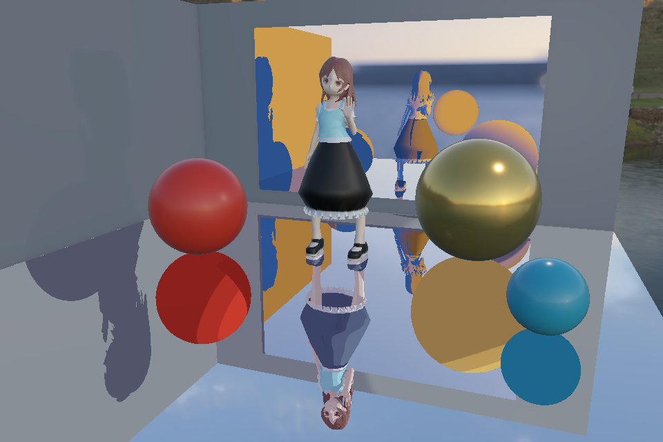

# Vulkan Rendering Lab

A C++17 / Vulkan real-time renderer exploring **animated ray-traced reflections, stylized mirror shading, and GPU-driven rendering**.

The showcase combines a PBR character with Toon and cool/warm mirrors. Both mirrors reflect the same GPU-skinned animation, including reflections of each other. Each mirror retains its own style along the reflection path, while the character in the main view keeps its original materials.



## Rendering highlights

- **Dynamic ray-traced mirrors.** Inline Ray Query traces animated scene geometry, including objects outside the camera view. GPU skinning feeds BLAS/TLAS updates every frame. Alpha-aware intersections preserve the character's cutout details.
- **Stylized reflections within reflections.** A bounded mirror path supports Toon and cool/warm shading. Styles compose from the innermost mirror outwards; environment filtering preserves sky detail. A runtime toggle compares the result with PBR.
- **Temporal SSAO.** Normal/depth prepass, half-resolution sampling, geometry-guided filtering and upsampling, motion reprojection, and history rejection address contact shading and temporal stability. AO affects indirect diffuse lighting.
- **GPU-driven visibility.** Compute frustum and current-frame Hi-Z culling compact visible IDs and populate indexed indirect commands across multiple mesh/material groups. Diagnostic views expose depth mips and per-object decisions.
- **PBR and rendering infrastructure.** glTF asset loading, GPU skeletal deformation, GGX shading, HDR image-based lighting, hard/PCF/PCSS shadows, and per-pass GPU timestamps provide the underlying renderer.

<details>
<summary>More rendering examples</summary>

**Temporal AO comparison**


**GPU visibility inspection**


</details>

## Build and run

Developed on Windows with Visual Studio 2022 and an NVIDIA RTX 4050 Laptop GPU. Requires **CMake 3.25+**, a **Vulkan SDK with `glslc`**, and GLFW, GLM, tinyobjloader and stb. The ray-tracing showcase additionally requires acceleration structures, buffer device address and Ray Query support; the ordinary raster demos do not enable ray-tracing features.

With an existing vcpkg installation and `VCPKG_ROOT` set, run in PowerShell:

```powershell
git clone https://github.com/XinyiRan0001/VulkanRenderingLab.git
cd VulkanRenderingLab

& "$env:VCPKG_ROOT/vcpkg.exe" install glfw3:x64-windows glm:x64-windows tinyobjloader:x64-windows stb:x64-windows
cmake -S . -B build -A x64 -DCMAKE_TOOLCHAIN_FILE="$env:VCPKG_ROOT/scripts/buildsystems/vcpkg.cmake" -DVCPKG_TARGET_TRIPLET=x64-windows
cmake --build build --config Release
```

Run from the repository root so asset and shader paths resolve:

```powershell
# Animated character with stylized ray-traced mirrors
.\build\Release\VulkanRenderingLab.exe --ray-query-scene --animated-scene assets/models/character/character.glb --animation Hello --paused

# Raster material and shadow lab
.\build\Release\VulkanRenderingLab.exe
```

In the mirror showcase: **F9** toggles stylized/PBR reflections, **F10** cycles ray diagnostics, **F11** toggles ray reflections, **Enter** pauses the character, and **F12** hides its playback panel. `--paused` freezes the light, independently of character playback.

## Validation and measurement

Twelve CTest targets cover asset loading, animation, visibility and rendering math. GPU verification tools compare deformed vertices and ray intersections against CPU references, check prepass consistency, and exercise playback and resource rebuilds with Vulkan synchronization validation.

```powershell
ctest --test-dir build -C Release --output-on-failure
.\tools\verify-mirror-styles.ps1
.\tools\verify-ray-character.ps1
```

GPU timestamps separate skinning, acceleration-structure updates and rendering work. Diagnostic readbacks are for correctness, not performance measurement. [Recorded culling measurements](docs/benchmarks/README.md) describe a specific older workload; they are not performance results for the animated mirror showcase.

## Current limits

Mirror paths trace at most three segments after the primary reflection; paths still hitting a mirror at the limit terminate. Reflections use ideal directions, without stochastic rough-reflection sampling or a reflection denoiser. The character path supports one shared base-color atlas and approximates translucent ray hits with alpha cutouts. One combined scene BLAS is refitted, including static geometry. Stylized shading is an artistic model rather than physically based light transport.

See [rendering notes and demo commands](docs/rendering-notes.md) for architecture, additional scenes and implementation boundaries.
