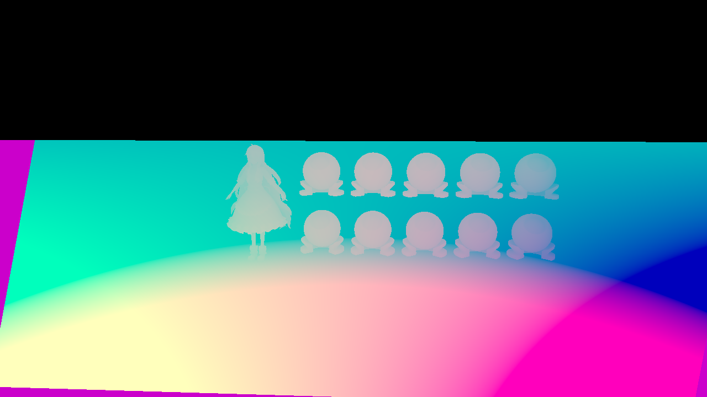
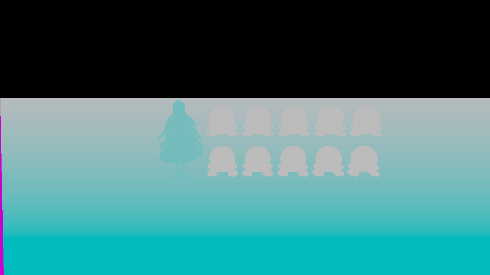
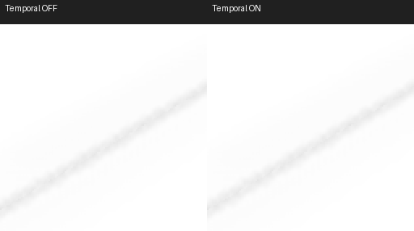
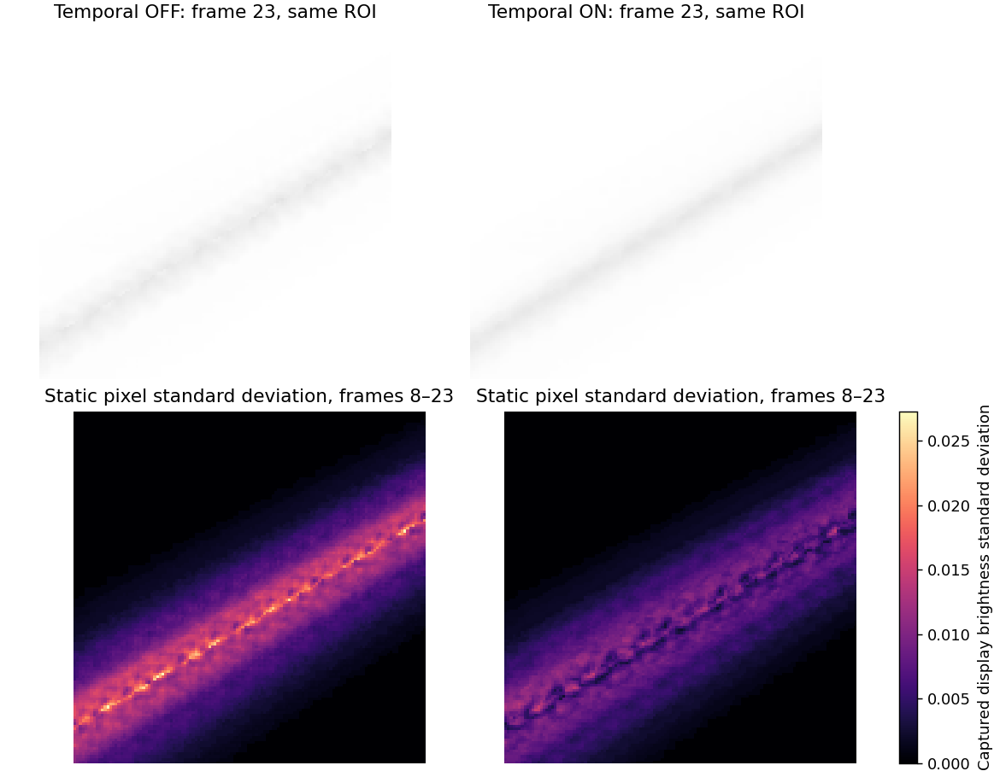
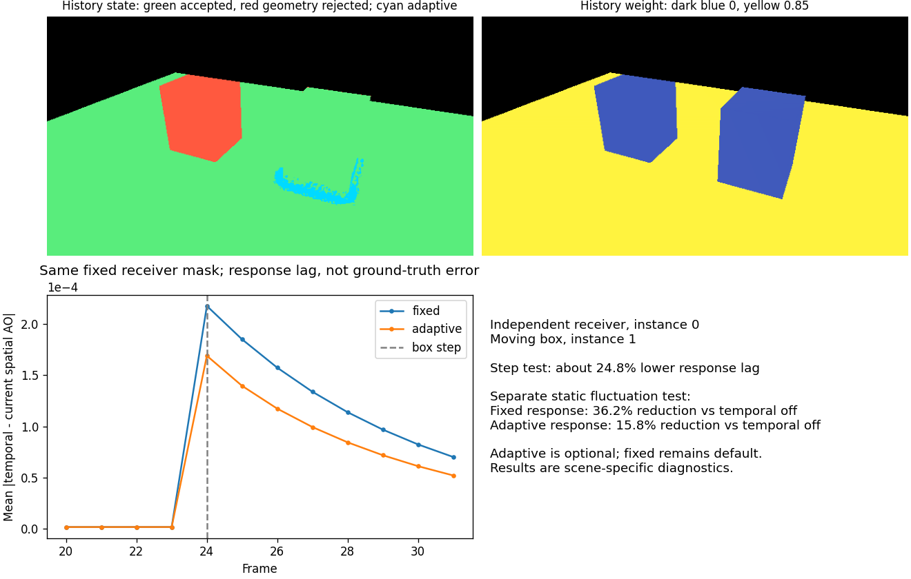
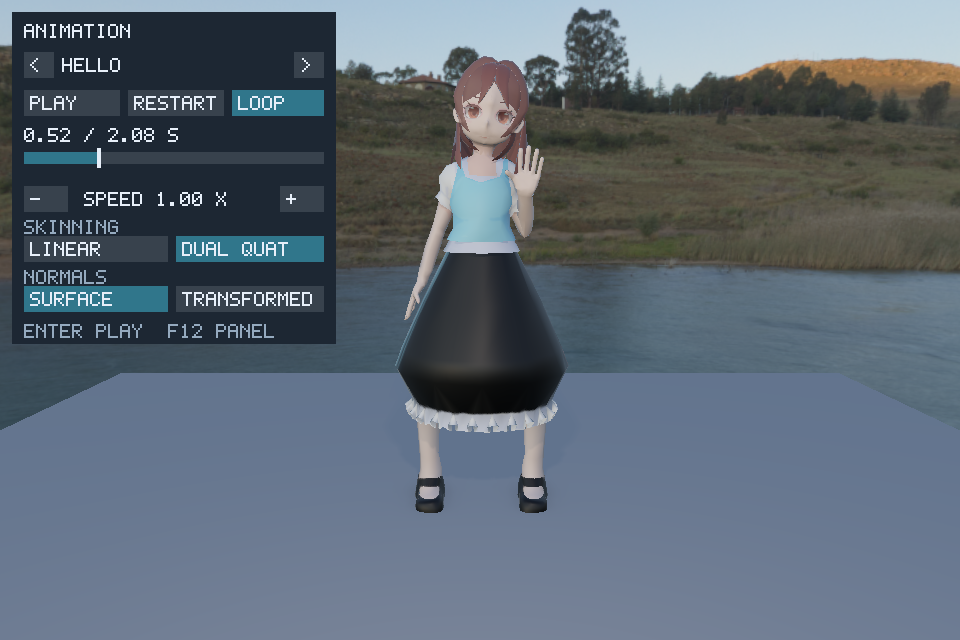
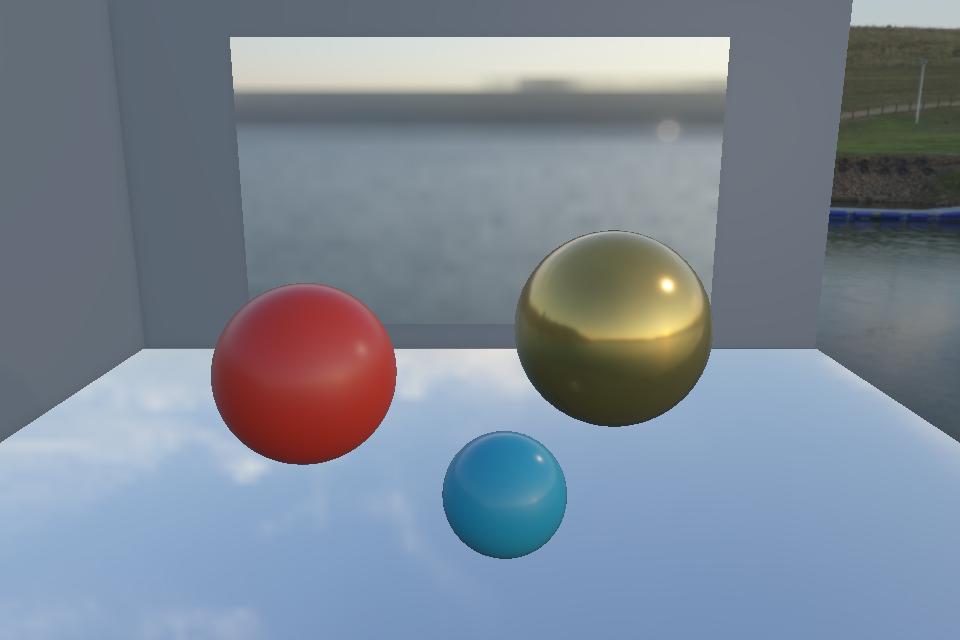
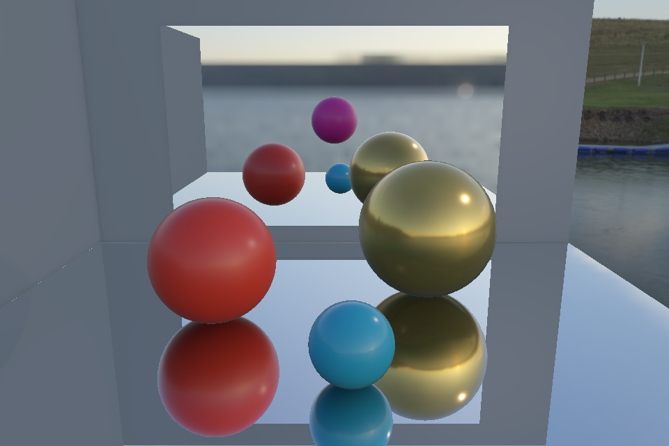
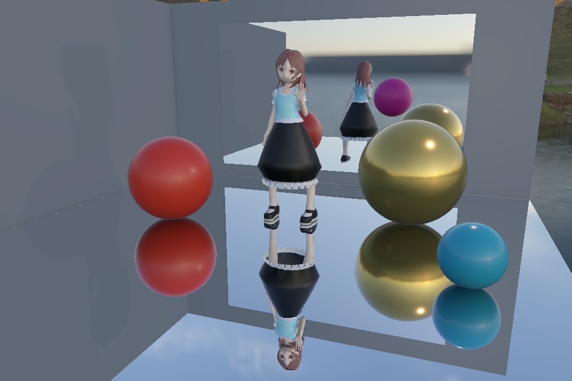

# Vulkan Rendering Lab

A modern real-time renderer built with **C++17** and **Vulkan**, featuring multi-pass rendering, real-time shadow mapping, Percentage-Closer Filtering (PCF), Percentage-Closer Soft Shadows (PCSS), GPU profiling, and benchmark-driven rendering optimization.

This project extends concepts studied in the **GAMES202: High-Quality Real-Time Rendering** course by implementing them within a custom Vulkan renderer instead of the original WebGL framework.

Rather than reproducing the original coursework, the project focuses on building a modular Vulkan renderer from scratch, integrating multiple shadow algorithms, profiling GPU execution using Vulkan Timestamp Queries, and evaluating rendering performance through benchmark-driven optimisation.

## Shared mesh instancing

The ten original material-lab objects now share one vertex/index mesh and use an
80-byte SSBO record per instance (transform + metallic/roughness/AO override).
Both main and shadow vertex shaders fetch binding 12 using `gl_InstanceIndex`.
The original model's two material ranges need two instanced draws per pass,
compared with twenty ball draws before. Character, floor and baked glTF geometry
use identity instance 0. The initial shared-mesh stage is now extended by GPU frustum culling and indirect
main-pass draws, described below. Shadow draws retain the full instance range.

A separate low-detail sphere field can exercise instance counts without repeating
the high-detail model's geometry:

```powershell
.\build\Release\VulkanRenderingLab.exe --stress-count 10000 --pitch 55 --paused
```

Stress mode supports 1..10000 instances and cannot be combined with `--scene`.
It uses a 153-vertex/672-index sphere (11,868 mesh bytes) plus 80 bytes per object.
It retains the existing light/shadow frustum; large-scene shadow coverage is limited.
Geometry storage and draw-call savings do not imply proportional GPU-time savings.

## GPU frustum culling and indirect rendering

A 64-thread compute shader tests conservative prototype bounding spheres against
the six Vulkan camera-frustum planes, compacts visible instance IDs using atomics,
and writes `VkDrawIndexedIndirectCommand.instanceCount` for each material range.
The main vertex shader remaps compact slots through the visible-ID buffer. CPU
camera-plane extraction is constant work; per-instance CPU tests occur only in
explicit verification mode. Rendering does not wait for a CPU-visible count to
choose its draw size. Character/floor/baked glTF draws retain the direct path;
each prototype has its own disjoint visible-ID partition and may have multiple
material ranges. Shadows deliberately draw every instance.

```powershell
.\build\Release\VulkanRenderingLab.exe --stress-count 10000 --camera-distance 8 --pitch 25 --paused
```

Press **C** to toggle frustum culling; the window title reports the most recently
completed frame's visible/total count. `--no-culling` runs GPU compaction in pass-through
mode; `--verify-culling` additionally reads back exact visible IDs for comparison
with an independent CPU frustum-test path. That mode is for correctness testing,
not performance measurement. Normal telemetry copies only indirect commands and small counter statistics.

The tested fixed stress view reduced main-pass ball instances from **10000 to 3016**
with **pixel-identical culling ON/OFF captures**; a camera shifted away produced
zero instances correctly. These are workload counts, not a GPU speedup claim.
GPU timestamps now include a Cull/Compact interval (reset, dispatch, dependencies
and diagnostic copy) as well as shadow and main passes. Hi-Z is available in the optional static-wall scene below. Transparent sorting,
async compute and a multi-frame output ring are not implemented.

The device selection requires a combined graphics+compute queue. Each indirect call
has drawCount=1 and firstInstance=0, avoiding optional multi-draw/nonzero indirect
first-instance feature requirements. Explicit transfer/compute/vertex/indirect/host
dependencies protect the outputs. Vulkan validation also prompted fixes to legacy
IBL push-constant stages, render-pass depth/external dependencies and per-image
present semaphores.

## Multiple prototypes and material ranges

```powershell
.\build\Release\VulkanRenderingLab.exe --mixed-scene --hiz-inspector --paused
```

This optional scene alternates spheres with rotating, blue/orange two-material
cubes. `--stress-count` is the **total** object count (default 1600, range 2..10000),
partitioned between the two prototypes. The existing character, floor and static
occluder wall remain. Add `--culling-observer` to inspect from the side.


**F11 / Shift+F11** select a group; **Tab / Shift+Tab** select an object within
it. `--inspect-group 1` starts on cubes. The inspector displays the selected
group's current GPU visible count and capacity; with the inspector off, the
window title reports both groups. The console prints per-group frustum and
occlusion counts. A fixed 1600-object view produced:

| Group | Total | Frustum survivors | Hi-Z rejected | Visible objects | Material draws |
|---|---:|---:|---:|---:|---:|
| Spheres | 800 | 427 | 46 | 381 | 1 |
| Cubes | 800 | 444 | 7 | 437 | 2 |

Both cube material draws consume the same 437 IDs, so the unique visible object
count is **818**, not the sum of all material command instance counts. Different
prototype bounds intentionally produce different rejection rates.

A 48-byte SSBO record per group defines its prototype sphere, source instance
range, visible-output base, indirect-command range and statistics index. One
64-thread compute kernel uses the dispatch Y dimension for groups and X for
instances. Each group's atomic counter reserves slots only inside its fixed
output partition. The vertex shader adds the group's visible base from material
push constants before remapping instance IDs. Commands retain firstInstance=0;
material descriptor binding and one indirect call per range remain explicit.
This extends GPU instance counts, not GPU-generated draw counts or bindless materials.

Layout construction rejects overlapping source ranges, inconsistent bounds and
oversized command templates. Material ranges can be interleaved in scene order;
an explicit draw-address table selects the correct command and visible base.
CPU/GPU verification compares sorted IDs **within each output partition**, checks
all material command counts and then verifies the aggregate. Shadows retain
full source ranges. The ordinary single-prototype and baked glTF paths remain.

Six CTest targets pass. Mixed-scene direct/frustum/Hi-Z captures are pixel-identical
at three fixed views. Moving/frozen camera checks, 10000 instances, unequal groups,
one empty group and both groups empty passed exact-ID and Vulkan synchronization
validation checks. These establish correctness; they are not a performance claim.

```powershell
.\tools\benchmark-culling.ps1 -MixedScene
```

The runner keeps mixed results separate as `mixed-<count>.csv`. Raw and summary
CSVs include a `geometry` field; a new `.batches.csv` records per-group counts,
capacities and draw ranges for each measured frame. The previously published
RTX 4050 sample is sphere-only and must not be treated as a mixed-scene result.

## Current-frame Hi-Z occlusion culling

An optional static-wall scene extends frustum culling with a current-frame depth
prepass, a max-reduction depth pyramid and conservative Compute occlusion tests:

```powershell
.\build\Release\VulkanRenderingLab.exe --occlusion-scene --paused
```

This starts a 1600-instance low-detail field with an opaque wall. **F8** toggles
Hi-Z rejection; **C** independently toggles frustum rejection. The window title
reports the latest completed frame's visible count and Hi-Z rejection count.
`--no-occlusion` starts the comparison with Hi-Z rejection disabled. The wall
prepass/pyramid still run in this mode, so it isolates rejection correctness,
not the total cost of enabling the Hi-Z infrastructure.

The prepass draws only explicit static opaque occluders, using the same camera
and baked wall geometry as the main pass. A sampled D32 depth image feeds a
compute-generated R32F pyramid. Its base is padded to power-of-two dimensions
with far depth 1, preserving coverage at non-power-of-two viewport edges. Each
subsequent mip stores the maximum of its 2x2 children for ordinary (non-reversed) Z.
The culling shader projects a conservative sphere-enclosing box, expands its
pixel rectangle, samples all covered cells at a selected mip, and rejects only
when the bound's nearest depth is behind the entire region. Near/eye-plane
crossing bounds bypass occlusion. Camera-frustum and Hi-Z rejection both feed
the existing visible-ID and indirect-draw path; shadows continue drawing all instances.


In the fixed default wall view, frustum culling retained **854/1600** instances;
Hi-Z rejected **92**, leaving **762** main-pass ball instances. Default, wall-edge
and near-wall Hi-Z ON/OFF framebuffer captures were **pixel-identical**. These
counts describe correctness/workload reduction, not a measured speedup. Timestamp
output separately reports **HiZ Setup** (prepass, pyramid and optional verification
copy), **Cull/Compact**, shadow, main and inclusive total time.

`--verify-culling` checks every pyramid parent against its children and compares
GPU visible IDs against CPU frustum/Hi-Z queries over the read-back pyramid. This
path intentionally performs large readbacks and is unsuitable for performance
measurement. Unit tests cover padding, conservative screen bounds, near/eye-plane
bypass, depth tolerance and uncovered regions; 24 changing-camera frames passed
Vulkan synchronization validation and complete ID checks. The comparison uses
only the authored static wall, not temporal depth, dynamic occluders, alpha-tested
materials or every scene object. There is no CPU-readback dependency for choosing
this frame's draw count. Hi-Z resources are only allocated in the optional scene.

## Hi-Z depth and single-instance inspector

```powershell
.\build\Release\VulkanRenderingLab.exe --occlusion-scene --hiz-inspector --paused
```

**F10** toggles the inspector. **Page Up / Page Down** cycle raw wall depth and
pyramid mips 0..11 at the default resolution. **Tab / Shift+Tab** select the
next/previous object. **F11 / Shift+F11** switch prototype groups.
`--inspect-instance 820` selects an offset within the selected group;
`--hiz-mip -1` previews raw depth, and `--hiz-mip 7` previews pyramid level 7.
Add `--culling-observer` to inspect the selected bound from an independent view.
Existing **C**, **F8**, **F9** controls remain available.


The inset shows only the explicitly authored wall depth, not full scene depth.
Purple marks power-of-two padding (stored as far depth 1). Grayscale is remapped
for contrast; the printed NEAR/MAX values and comparisons use unmodified device
depth. Coarse mips show texel boundaries. The yellow world-space box marks the
selected conservative bound, cyan marks its expanded projected rectangle, and
the status-colored rectangle marks the query cells' full coverage.

**Preview mip** is a manual display choice; **query mip** is selected automatically
from the bound size, spanning at most 2x2 cells. They are independent. The selected
query compares its nearest depth with the maximum depth of those cells:
`NEAR > MAX + 0.000100` means geometrically covered. In the fixed default view,
sphere 820 queries mip 7: **0.987150 > 0.983882 + 0.000100**, matching actual rejection.

Red means Hi-Z rejected, green means retained, orange means frustum rejected,
and gray means a near/eye-plane or offscreen query was bypassed. Invalid queries
show N/A. With F8 off the geometric query is still visible but cannot reject the
sphere; the HIZ OFF label distinguishes that case. Retained means present in the
instance draw list, not necessarily producing pixels after ordinary rasterization.

The diagnostic independently uses the CPU reference footprint and a one-thread
GPU query of the current pyramid; it never modifies culling outputs. Normal
inspection reads back only 16 diagnostic bytes after the frame fence. With
`--verify-culling`, sampled depth is checked against the CPU pyramid reference and
the decision against the actual GPU visible-ID list. Raw/mip 0/7/11 captures,
36 moving-camera frames and 12 frozen-camera observer frames passed these checks
and Vulkan synchronization validation. Inspector-off benchmark paths still
produce pixel-identical direct/frustum/Hi-Z captures at all three fixed views.
The inspector dispatch and overlay are omitted when off and during benchmarks.

## Automated culling performance benchmark

```powershell
.\tools\benchmark-culling.ps1
```

Tests 1600 / 6400 / 10000 instances at three fixed viewing angles. Each mode
gets its own warmup and three rotated repetitions, exporting per-frame CSV and
mean/median/p95 summaries. Unlike interactive C/F8 toggles, the direct baseline
skips compute culling entirely and the frustum-only path skips the complete
Hi-Z depth prepass and pyramid. Inputs are locked and light animation is paused.

On one RTX 4050 Laptop GPU run at 1280 x 720, the 10000-instance front view
averaged **2.643 ms direct**, **2.273 ms frustum**, **2.264 ms frustum + Hi-Z**.
The incremental Hi-Z difference is too small to establish a benefit; edge and
side views often became slower with Hi-Z. These are local GPU execution timings,
not end-to-end FPS or a universal speedup claim.

See [measurement conditions, all views and summary CSV](docs/benchmarks/README.md)
for the results and reproduction commands. Six tests pass; separate validation
runs produced pixel-identical direct/frustum/Hi-Z captures at 1600 instances for all three views.

## Character and Material Lab

The default scene retains the existing character and ten material test objects.
The character has one base-color texture; the repository contains no authored
normal/roughness maps for it. The material objects compare the same base color
across **metallic 0 (top row)** and **metallic 1 (bottom row)**. Roughness increases
left to right: **0.02, 0.20, 0.45, 0.70, 1.00**. The grid is placed to the right of
the character, above the floor, and the default/reset camera frames both.

```powershell
.\build\Release\VulkanRenderingLab.exe
```

| Key | Material inspection |
|---|---|
| `V` | Cycle shaded, base color, world normal, roughness, metallic, AO |
| `E` | Toggle environment lighting independently of the background |
| `H` | Toggle background visibility only |
| `F7` | Cycle combined, direct only, diffuse IBL only, specular IBL only |
| `[` / `]` | Rotate environment lookup by -/+15 degrees |
| `F5` / `F6` | Adjust exposure for both background and shaded objects |

The window title reports the selected material/lighting views and IBL state.
Material views bypass lighting, shadows, exposure and tone mapping. Lighting
component views exclude fallback ambient/emissive so each contribution can be
inspected separately. With IBL disabled, both IBL-only views are black.
Rotation affects the background and both IBL lookups consistently, without
regenerating cubemaps. Background and object exposure now use the same exponential
tone mapping. The component views describe this renderer's split-sum IBL model;
they are not ground-truth reference renders.

For a reproducible view at startup (numeric modes follow the orders above):

```powershell
.\build\Release\VulkanRenderingLab.exe --material-view 3
.\build\Release\VulkanRenderingLab.exe --lighting-view 3 --environment-degrees 45
```

### Irradiance cubemap seam correction

The reported polygon-shaped patches on the rear of the material objects were
reproduced even with shadows disabled. Fixed-camera captures isolated the problem
to diffuse IBL, rather than PCSS. The irradiance generation draw loop omitted each
face's push-constant view-projection matrix and its dynamic viewport/scissor.
Cubemap capture passes also applied a screen-style Y flip despite face up vectors
already following cube lookup conventions, and face culling could leave faces
unrendered. Each irradiance face now records all required state, all three cube
capture passes use the same unflipped projection convention, and capture cubes
render without face culling. A fixed rear-view comparison confirms the reported
patch boundary disappears with PCSS still enabled.


To capture the renderer's own framebuffer for repeatable regression inspection:

```powershell
.\build\Release\VulkanRenderingLab.exe --paused --yaw -135 --pitch 18 --shadow-mode 3 --frames 1 --capture build/ibl-check.png
```

`--shadow-mode 0` disables shadows for isolation; 1/2/3 select hard/PCF/PCSS.
`--capture` saves the next rendered frame as PNG, before presentation; it requires
surface transfer-source support and an existing output directory. Captures wait
for GPU readback and must not be used for performance measurements.

## Static glTF 2.0 asset pipeline

The renderer now imports static `.gltf` and `.glb` scenes with hierarchical node
transforms and per-material base color, normal, metallic-roughness, occlusion and
emissive textures. Base color/emissive textures use sRGB formats; normal/MR/AO
textures use linear UNORM formats. Normal maps use exported tangent frames,
including mirrored transform handedness. Existing OBJ demo controls remain available.

From the repository root, after a Release build:

```powershell
.\build\Release\VulkanRenderingLab.exe --scene assets/models/gltf-validation/scene.glb
```

Omit `--scene` to run the original OBJ/material-ball demonstration. Use `--frames 3`
for a bounded GPU smoke run. The original validation scene includes two materials,
nested transforms, nonuniform scale, a mirrored instance, and all five texture slots.
It is a correctness fixture, rather than a finished portfolio showcase scene.

The initial importer supports opaque, single-sided static triangle meshes with
`TEXCOORD_0`, external image files and GLB embedded PNG/JPEG images. Normal-mapped
meshes must export tangents. Unsupported inputs produce an error: animation,
skinning, morph targets, sparse accessors, vertex colors, image data URIs, required
extensions, texture transforms, additional texture UV sets, transparency, and
custom/mipmapped samplers. Textures currently have one mip level, using linear
filtering with repeat addressing. Node transforms are baked into imported geometry;
repeated mesh instances currently duplicate CPU geometry. Imported cameras/lights
are not used; the renderer retains its own orbit camera and point light. Asset
scale and framing may need adjustment for arbitrary scenes.

Shaders compile automatically during CMake builds. The existing runtime shader
paths expect the build directory to be named `build` and execution from the repo root.
The parser is vendored [cgltf v1.15](https://github.com/jkuhlmann/cgltf/tree/v1.15)
under its MIT license. Texture channels follow the
[glTF 2.0 specification](https://registry.khronos.org/glTF/specs/2.0/glTF-2.0.html).

Loader regression tests (no GPU required):

```powershell
cmake --build build --config Release
ctest --test-dir build -C Release --output-on-failure
```

Regenerate original fixtures with `python tools/generate_gltf_validation.py`.
Tests cover both containers, embedded/external images, hierarchical transforms,
mirrored winding and tangent handedness, material selection, and rejection of
unsupported or corrupt input. These checks and GPU smoke runs do not replace
visual comparison against a reference glTF viewer.

---

# Features

## Rendering

- Vulkan 1.3 Renderer
- Forward Rendering
- Multi-pass Rendering
- OBJ Model Loading
- Multiple Materials
- Texture Mapping
- Dynamic Lighting
- Orbit Camera
- Runtime Shadow Mode Switching

---

## Shadow Mapping

Implemented multiple real-time shadow techniques:

- Hard Shadow
- Percentage-Closer Filtering (PCF)
- Percentage-Closer Soft Shadows (PCSS)
- Shadow Map Debug View

The renderer generates a shadow map from the light's point of view and samples it during the main rendering pass.

---

## Dynamic Lighting

A movable point light is supported.

The light automatically orbits around the scene while continuously updating:

- Light position
- Light View Matrix
- Shadow Projection Matrix

This enables fully dynamic shadows without restarting the renderer.

---

## Orbit Camera

The renderer provides an interactive orbit camera supporting:

- Mouse rotation
- Zoom
- Camera reset
- Adjustable distance
- Adjustable pitch
- Adjustable yaw

---

## Shadow Map Debug

A dedicated debug mode visualises the generated shadow map directly on screen.

Useful for inspecting:

- Shadow camera coverage
- Depth precision
- Shadow bias
- Projection artifacts

---

# Runtime Controls

| Key | Function |
|-----|----------|
| **1** | Hard Shadow |
| **2** | Percentage-Closer Filtering (PCF) |
| **3** | Percentage-Closer Soft Shadows (PCSS) |
| **4** | Shadow Map Debug |
| **P** | Toggle Dynamic Lighting |
| **Space** | Pause / Resume Light Animation |
| **M** | Toggle Orbit / Manual Light Mode |
| **J / L** | Move Light (X Axis) |
| **I / K** | Move Light (Z Axis) |
| **U / O** | Move Light (Y Axis) |
| **Left Mouse** | Rotate Camera |
| **Mouse Wheel** | Zoom Camera |
| **R** | Reset Camera |
| **B** | Run 5-second GPU Benchmark |
| **Esc** | Exit |

---

# Project Highlights

- Modular Vulkan renderer architecture
- Multi-pass rendering pipeline
- Runtime shadow algorithm switching
- GPU profiling using Vulkan Timestamp Queries
- Benchmark-driven rendering optimisation
- GAMES202-inspired rendering research

# Rendering Pipeline

The renderer uses two primary rendering passes:

1. Shadow Pass
2. Main Camera Pass

```text
Scene Geometry
      |
      v
Shadow Pass
      |
      v
Shadow Depth Image
      |
      v
Main Camera Pass
      |
      +----------------------+
      |                      |
      v                      v
Material Texture        Shadow Map
      |                      |
      +----------+-----------+
                 |
                 v
        Lighting Calculation
                 |
                 v
           Final Image
```

## Shadow Pass

The shadow pass renders scene geometry from the active shadow-casting light.

It performs the following operations:

1. Uses the light view-projection matrix
2. Renders all scene submeshes
3. Writes depth values into a 2048 �� 2048 shadow depth image
4. Makes the resulting depth image available to the main camera pass

The pass uses a dedicated:

- Shadow Render Pass
- Shadow Framebuffer
- Shadow Graphics Pipeline
- Depth Image
- Vertex Shader
- Descriptor Set

Only depth information is required, so the shadow pass does not produce a colour attachment.

## Main Camera Pass

The main pass renders the scene from the active camera.

It performs the following operations:

1. Samples material textures
2. Calculates direct lighting
3. Transforms world positions into shadow-map coordinates
4. Samples the shadow depth image
5. Applies the selected shadow algorithm
6. Writes the final image to the swapchain framebuffer

The active shadow mode is passed to the fragment shader through the shared uniform buffer.

---

# Shadow Algorithms

## Hard Shadow

Hard Shadow performs a single comparison between the receiver depth and the stored shadow-map depth.

```text
Receiver Depth
      |
      v
Shadow Depth Comparison
      |
      +---- Visible
      |
      +---- Shadowed
```

This technique is computationally inexpensive but produces sharp, aliased shadow boundaries.

It is used as the baseline for visual and performance comparisons.

## Percentage-Closer Filtering

Percentage-Closer Filtering performs multiple depth comparisons in a neighbourhood around the shadow coordinate.

The visibility results are averaged to produce a smoother shadow boundary.

```text
Neighbouring Shadow Samples
      |
      v
Multiple Depth Comparisons
      |
      v
Average Visibility
      |
      v
Filtered Shadow
```

The current implementation uses a fixed sampling kernel.

Compared with Hard Shadow, PCF reduces visible aliasing at the cost of additional shadow-map texture samples.

## Percentage-Closer Soft Shadows

Percentage-Closer Soft Shadows approximates contact-hardening shadows.

The algorithm consists of two main stages:

### 1. Blocker Search

The shader searches a neighbourhood around the receiver to find shadow-map samples that are closer to the light than the receiver.

The average blocker depth is then calculated.

### 2. Variable-Radius Filtering

The distance between the blocker and receiver is used to estimate the penumbra width.

```text
Blocker Search
      |
      v
Average Blocker Depth
      |
      v
Receiver-to-Blocker Distance
      |
      v
Penumbra Estimation
      |
      v
Variable-Radius PCF
```

This produces shadows that remain relatively sharp near contact areas and become softer as the receiver moves farther away from the blocker.

Because the shadow map is generated using a perspective projection, stored depth values are linearised before blocker-distance and penumbra calculations.

---

# GPU Profiling

The renderer includes a lightweight GPU profiling system implemented with Vulkan Timestamp Queries.

Timestamp queries are recorded directly into each command buffer around the two rendering passes.

```text
Timestamp 0
      |
      v
Shadow Pass
      |
      v
Timestamp 1

Timestamp 2
      |
      v
Main Camera Pass
      |
      v
Timestamp 3
```

The profiler calculates:

- Shadow Pass GPU time
- Main Camera Pass GPU time
- Total measured GPU time
- Continuously averaged GPU timings
- Sample count for each reporting interval

GPU timestamp ticks are converted into nanoseconds using the physical device's `timestampPeriod` value and then converted into milliseconds.

## Timestamp Query Sequence

Each recorded command buffer performs the following operations:

```text
Reset Timestamp Query Pool
      |
      v
Write Shadow Start Timestamp
      |
      v
Execute Shadow Pass
      |
      v
Write Shadow End Timestamp
      |
      v
Write Main Pass Start Timestamp
      |
      v
Execute Main Camera Pass
      |
      v
Write Main Pass End Timestamp
```

Query results are read only after the associated in-flight fence has completed.

This ensures that the GPU has finished executing the command buffer before timing data is accessed.

## Runtime Timing Output

GPU timings are accumulated and reported approximately every 0.5 seconds.

Example:

```text
[GPU Timing Average] Shadow: 0.159 ms | Main: 0.187 ms | Total: 0.348 ms | Samples: 145
```

Averaging multiple samples reduces the effect of individual-frame timing fluctuations.

---

# Automated GPU Benchmark

Pressing `B` starts a five-second benchmark for the currently selected shadow mode.

During the benchmark, the renderer:

1. Records the active shadow mode
2. Resets benchmark accumulators
3. Collects GPU timings continuously
4. Calculates average pass times
5. Reports the final result with the total sample count

Example output:

```text
========================================
[GPU Benchmark Result]
Mode:        PCSS
Shadow Pass: 0.164 ms
Main Pass:   0.231 ms
Total GPU:   0.396 ms
Samples:     1392
========================================
```

The benchmark mode supports:

- Hard Shadow
- PCF
- PCSS
- Shadow Map Debug View

The selected mode is stored when the benchmark begins, preventing the final result from being incorrectly labelled if runtime controls are used.

---

# GPU Performance Benchmark

GPU execution time was measured using Vulkan Timestamp Queries.

Each shadow mode was benchmarked continuously for five seconds.

| Shadow Mode | Shadow Pass | Main Pass | Total GPU |
|---|---:|---:|---:|
| Hard Shadow | 0.160 ms | 0.060 ms | 0.221 ms |
| PCF | 0.184 ms | 0.120 ms | 0.306 ms |
| PCSS (Optimized) | 0.164 ms | 0.231 ms | 0.396 ms |

> Results were captured in the current demo scene and should be interpreted as a comparison between algorithms rather than a universal hardware benchmark.

## Performance Analysis

The Shadow Pass performs approximately the same work for every shadow mode because all three modes use the same generated shadow map.

The most meaningful comparison is therefore the Main Pass, where the filtering algorithms are executed.

| Shadow Mode | Main Pass | Relative Cost |
|---|---:|---:|
| Hard Shadow | 0.060 ms | 1.00�� |
| PCF | 0.120 ms | 2.00�� |
| PCSS (Optimized) | 0.231 ms | 3.85�� |

PCF approximately doubled the measured Main Pass time compared with Hard Shadow.

PCSS remained the most expensive mode because it performs both:

- Blocker-search samples
- Variable-radius filtering samples

The benchmark demonstrates the visual-quality and GPU-cost trade-off between the implemented shadow algorithms.

## Measurement Notes

Benchmark values may vary depending on:

- GPU clock state
- Background applications
- Window size
- Build configuration
- Camera position
- Light position
- Visible shadow coverage
- Driver behaviour

For consistent comparisons, the same scene, camera position, lighting configuration, window size, and build configuration should be used.

---

# PCSS Correctness and Optimisation

The PCSS path uses a 25-tap blocker search and a 49-tap variable-radius filter.
It retains the standard no-blocker early return. Any search that finds blockers
continues through penumbra estimation and filtering.

An earlier implementation returned fully shadowed when all 25 blocker-search
samples were occluded. That shortcut was removed during the investigation of hard patches
reported on the material test objects. The search radius is 5 texels, while
the final filter radius can reach 18 texels: an entirely occluded search footprint
does not imply an entirely occluded filter footprint. Skipping filtering could
introduce an artificial discontinuity.

The remaining wide-kernel self-shadowing path now applies receiver-plane depth
correction to each blocker-search and filtering sample. A screen-space derivative
Jacobian converts the receiver depth slope into shadow UV space; comparison depth
is evaluated at the actual sampled texel center. The blocker depth is brought back
to the center ray for penumbra estimation. PCSS uses unfiltered `texelFetch` depths,
avoiding interpolation between unrelated depth surfaces before comparison.
This follows the per-sample gradient approach described in NVIDIA's
[PCSS integration guide](https://developer.download.nvidia.com/assets/gamedev/docs/PCSS_Integration.pdf).
It is a local planar approximation; large kernels over strongly curved surfaces
and silhouette regions can still need further quality work. Hard/PCF paths remain
unchanged for comparison. The later framebuffer investigation below isolated the reported polygon-shaped
patches to diffuse IBL. These PCSS correctness changes were not sufficient to fix
that separate irradiance-generation defect.

Historical measurements of 0.248 ms before that shortcut and 0.231 ms after it
(about 7% lower main-pass time) describe the earlier, approximate implementation.
They do not establish the performance of the corrected shader. The benchmark
tables above also predate this correction and the material-grid layout changes;
rerun benchmarks at fixed camera/light settings before using those numbers in a
resume or reporting a current speedup. Compilation and smoke tests do not confirm
that every visible shadow artifact has been resolved; visual comparison is needed.

---

# Visual Quality and Performance Trade-Off

Each implemented algorithm serves a different rendering goal.

| Technique | Visual Result | GPU Cost | Use Case |
|---|---|---:|---|
| Hard Shadow | Sharp edges | Lowest | Baseline or highly constrained rendering |
| PCF | Uniformly softened edges | Moderate | General-purpose filtered shadows |
| PCSS | Contact-hardening soft shadows | Highest | Higher-quality dynamic shadows |

Hard Shadow offers the best performance but the lowest visual quality.

PCF provides a practical balance between quality and cost.

PCSS provides the most realistic result of the three techniques but requires substantially more shadow-map sampling.

The runtime mode-switching and benchmark tools make these trade-offs directly observable within the application.

### Physically Based Rendering and Image-Based Lighting

- Cook-Torrance BRDF with metallic-roughness materials
- HDR equirectangular environment loading
- Runtime HDR-to-cubemap conversion
- Diffuse irradiance convolution
- GGX prefiltered environment cubemap with roughness mip levels
- Split-sum BRDF integration LUT
- Diffuse and specular image-based lighting
- Tone-mapped HDR lighting composition
- Material validation grid covering dielectric and metallic surfaces

# Build and Run

## Requirements

- Windows 10/11
- Visual Studio 2022
- CMake
- Vulkan SDK
- A Vulkan-compatible GPU
- Git

The project has been developed and tested with an NVIDIA RTX 4050 Laptop GPU.

## Clone the Repository

```bash
git clone https://github.com/XinyiRan0001/VulkanRenderingLab.git
cd VulkanRenderingLab
```

## Configure

```bash
cmake -B build -S .
```

## Build

Debug:

```bash
cmake --build build --config Debug
```

Release:

```bash
cmake --build build --config Release
```

## Run

Debug:

```bash
.\build\Debug\VulkanRenderingLab.exe
```

Release:

```bash
.\build\Release\VulkanRenderingLab.exe
```

> **Note:** Run the executable from the project root directory so that shaders, models, textures, and HDR assets can be loaded correctly.

---

# Controls

## Camera

| Input | Action |
|--------|--------|
| Left Mouse Drag | Orbit camera |
| Mouse Wheel | Zoom |
| `R` | Reset camera |
| `Esc` | Exit application |

Default camera after reset:

```text
Yaw      : 0.0
Pitch    : 0.15
Distance : 3.5
```

---

## Shadow Modes

| Key | Mode |
|-----|------|
| `1` | Hard Shadows |
| `2` | Percentage-Closer Filtering (PCF) |
| `3` | Percentage-Closer Soft Shadows (PCSS) |
| `4` | Shadow Map Debug View |

Example:

```text
[Shadow] Mode: PCSS
```

---

## HDR & Skybox

| Key | Action |
|-----|--------|
| `H` | Toggle Skybox |
| `F5` | Decrease HDR Exposure |
| `F6` | Increase HDR Exposure |

Exposure is adjusted in increments of **0.1** and clamped between:

```text
0.1 ~ 5.0
```

Console output:

```text
[HDR] Exposure: 1.30
```

---

## Point Light

### Toggle

| Key | Action |
|-----|--------|
| `P` | Enable / Disable Point Light |
| `Space` | Pause / Resume Animation |
| `M` | Toggle Manual Control |

Console example:

```text
[Point Light] Enabled
[Point Light Animation] Paused
[Point Light] Control Mode: Manual
```

---

### Manual Control

When **Manual Control** is enabled (`M`):

| Key | Movement |
|-----|----------|
| `J` | Move Left (-X) |
| `L` | Move Right (+X) |
| `I` | Move Forward (-Z) |
| `K` | Move Backward (+Z) |
| `U` | Move Up (+Y) |
| `O` | Move Down (-Y) |

Each key press moves the light by approximately **0.15 world units**.

---

# GPU Benchmark

Press:

```text
B
```

to benchmark the currently selected shadow mode.

Example workflow:

```text
3
↓
B
```

Console output:

```text
========== GPU BENCHMARK ==========
Mode: PCSS
Shadow Pass: 0.164 ms
Main Pass:   0.231 ms
Total:       0.396 ms
Samples:     1392
===================================
```

Recommended benchmarking sequence:

1. Press `1` then `B` (Hard Shadows)
2. Press `2` then `B` (PCF)
3. Press `3` then `B` (PCSS)

This allows direct comparison of rendering quality and GPU cost.

---

# Demonstration Guide

A recommended order for demonstrating the renderer:

1. Rotate the camera around the scene.
2. Toggle the HDR skybox (`H`).
3. Adjust HDR exposure (`F5` / `F6`).
4. Compare Hard Shadows, PCF, and PCSS (`1`, `2`, `3`).
5. Display the Shadow Map Debug View (`4`).
6. Enable or disable the point light (`P`).
7. Pause the point light animation (`Space`).
8. Switch to Manual Control (`M`) and move the light (`J`, `L`, `I`, `K`, `U`, `O`).
9. Benchmark each shadow mode (`B`).

---

# Keyboard Shortcuts

| Category | Key | Function |
|----------|-----|----------|
| Camera | Left Mouse Drag | Orbit camera |
| Camera | Mouse Wheel | Zoom |
| Camera | `R` | Reset camera |
| Camera | `Esc` | Exit |
| Shadows | `1` | Hard Shadows |
| Shadows | `2` | PCF |
| Shadows | `3` | PCSS |
| Shadows | `4` | Shadow Map Debug |
| SSAO | `F1` | Switch full / half AO resolution (rebuilds renderer resources) |
| SSAO | `F2` | Toggle plane-aware / camera-depth blur guidance |
| SSAO | `G` | Cycle filtered AO / history status / history weight views |
| SSAO | `J` | Toggle fixed / deterministic per-frame AO samples |
| SSAO | `T` | Toggle temporal accumulation; title shows ON/OFF |
| SSAO | `F3` | Toggle indirect-diffuse AO composition / off |
| SSAO | `F4` | Cycle normal, depth, raw AO, blurred AO, composite and motion views |
| HDR | `H` | Toggle Skybox |
| HDR | `F5` | Exposure - |
| HDR | `F6` | Exposure + |
| Point Light | `P` | Enable / Disable |
| Point Light | `Space` | Pause / Resume Animation |
| Point Light | `M` | Manual / Orbit Mode |
| Point Light | `J` | Move Left |
| Point Light | `L` | Move Right |
| Point Light | `I` | Move Forward |
| Point Light | `K` | Move Backward |
| Point Light | `U` | Move Up |
| Point Light | `O` | Move Down |
| Benchmark | `B` | Start GPU Benchmark |
### Frozen culling camera observer

```powershell
.\build\Release\VulkanRenderingLab.exe --occlusion-scene --culling-observer --paused
```

The startup option snapshots the configured culling camera and moves the viewing
camera aside. **F9** toggles frozen/live culling; mouse orbit and wheel zoom move
the observer. **C** toggles frustum rejection, **F8** toggles Hi-Z rejection.
Disable both to see all instances, then enable C and F8 in sequence. Missing
objects in this mode are intentional: visibility belongs to the frozen camera,
not to the observer. The yellow overlay shows that camera's frustum through
scene geometry. For readability its rays are capped at 20 world units; this cap
has no effect on the actual culling far plane. The title identifies FROZEN/LIVE.
Hi-Z depth and frustum planes always use the same culling camera. Normal rendering
and shading use the live observer. Shadow draws still include all instances.

Observer validation: a 12-frame yaw sweep retained exactly the same 762 visible
IDs while the observer moved; CPU/GPU verification passed every frame. Vulkan
validation and synchronization validation reported no errors in this run.
With both rejection switches disabled the same frozen camera retains all 1600.


### Full-scene normal/depth prepass (SSAO foundation)

The SSAO path now includes sampled scene geometry buffers, raw AO, bilateral
filtering and optional indirect-diffuse composition. It is separate from the wall-only Hi-Z
occluder pass. The character, floor, material balls and instanced/glTF geometry
use the same camera, object transforms and position operation order as forward
rendering. Sky/background pixels are explicitly marked invalid.

```powershell
cmake --build build --config Release
.\build\Release\VulkanRenderingLab.exe --prepass-view normal
.\build\Release\VulkanRenderingLab.exe --prepass-view depth --depth-range 10
# Diagnostic readback; adds GPU/CPU work, unsuitable for performance comparison:
.\build\Release\VulkanRenderingLab.exe --prepass-view normal --verify-prepass --paused --frames 3
```

**F4** cycles Off → View Normal → Linear Depth → World Normal → Raw SSAO →
Blurred SSAO → SSAO Composite → Motion → Off. **F3** toggles Composite / Off.
`--prepass` keeps shaded rendering while executing the prepass. Geometric
normals are stored in view space (normal maps are not applied), using the inverse
transpose for object transforms. RGBA16F stores unit normal XYZ and positive
view distance `-viewPosition.z` in alpha, with RGBA32F as a checked fallback.
A sampled D32 image stores Vulkan device depth in [0,1]. The depth preview
reconstructs view position through the actual inverse projection and maps
positive distance / `--depth-range` to grayscale; purple identifies background.


Attachment-write → fragment-read and next-use read → attachment-write
dependencies are explicit. Current rendering has one frame in flight: the frame
fence protects shared images, uniform updates and diagnostic readback. Multiple
frames in flight would require independent resources or equivalent synchronization.
Window resize preserves CPU camera/debug/light state and recreates resources
and descriptors after GPU completion. This first implementation rebuilds the
whole renderer, including IBL, and therefore briefly pauses during resize.

`--verify-prepass` checks unit normals, background coverage, reconstructed linear
distance against interpolated view distance, and prepass depth against main-pass
depth. Main depth is retained for this diagnostic only. Frozen-culling observer
mode deliberately skips the main-depth comparison because its visible draw list
belongs to another camera. Verification reads the actual GPU attachments.
Regular GPU timing reports Prepass separately and measures Total with its own
start/end timestamps; readback/debug rendering adds overhead.

Validation on 2026-10-19: default scene, a 12-frame mixed-scene camera sweep,
glTF validation scene at 961×541, and resize 1280×720 → 1024×768 passed attachment
readback checks with zero observed main-depth difference. Vulkan validation and
synchronization validation reported no errors in those runs. Six CTest tests
passed. Prepass-only shaded output matched the baseline pixel-for-pixel; the
resized normal view matched a fresh run at the same dimensions. RenderDoc captured the normal view; its structured capture confirms
RGBA16F/D32 attachments, five prepass indexed draws, sampling layouts and the
prepass → shadow → main ordering. This does not validate future AO quality.

An optional `--renderdoc-capture` flag triggers one capture when launched through
RenderDoc; Windows uses the bundled MIT-licensed RenderDoc application API header
in `third_party/renderdoc/renderdoc_app.h`. RenderDoc is not required for normal
execution. Captures and logs remain in the ignored build directory.


### Raw SSAO

```powershell
.\build\Release\VulkanRenderingLab.exe --ssao-view
.\build\Release\VulkanRenderingLab.exe --ssao-view --ao-radius 0.5 --ao-bias 0.025 --ao-samples 64
.\tools\verify-ssao.ps1
```

An 8×8 compute dispatch reads prepass geometric normals and device depth,
reconstructs view-space positions, and rotates a fixed hemisphere kernel with a
stable 4×4 rotation tile. A floating-point R32F image stores raw visibility:
**1 = unoccluded, 0 = fully occluded**. The separate fullscreen preview samples
that image. This view intentionally displays the unfiltered result, without contrast boost
or lighting composition. `--ssao` selects the separate final composition mode.

`--ao-radius` is in scene/view units (default 0.5, positive and at most 10),
`--ao-bias` avoids self-occlusion (default 0.025, nonnegative and below radius),
and `--ao-samples` selects 1–64 kernel entries (default 32). Radius is applied
before projection, so it is independent of camera distance. A receiver tangent-plane test rejects coplanar self-occlusion from
pixel-center snapping; a smooth distance weight rejects distant depth layers. Background, out-of-bounds and clipped
samples contribute no occlusion; the denominator remains the configured sample
count to avoid artificially dark screen edges. Missing offscreen/hidden geometry
can therefore cause under-occlusion, a screen-space limitation.

Attachment writes explicitly become visible to compute sampling. AO storage
writes transition to fragment sampling/optional diagnostic transfer reads before
use. Existing single-frame fence and resize lifecycle also protect the AO image,
its descriptors and parameters. Raw AO and blur compute run in all three AO modes (raw, blurred, composite).
GPU timing reports SSAO and Blur independently of Prepass and the complete frame
interval; raw-view timing therefore also includes the blur stage.

`--verify-prepass` in Raw SSAO mode also reads the actual R32F output and checks
finite [0,1] values and exactly white background. Original embedded glTF fixtures
in `assets/models/ssao-validation` isolate a plane and a perpendicular wall/plane
join. A repeatable GPU acceptance script checks them from two camera distances;
ordinary CTest remains independent of GPU/window availability. Default-scene
orbit, 16/64-sample settings and resize were also checked under Vulkan and
synchronization validation. No error was observed in those runs. These checks do
not guarantee artifact-free AO for all scenes.

The raw AO and corner screenshots below use the default 32 samples.


### Bilateral AO filtering and indirect-diffuse composition

```powershell
.\build\Release\VulkanRenderingLab.exe --ssao
.\build\Release\VulkanRenderingLab.exe --ssao-blurred
# Isolate indirect diffuse to inspect the AO contribution:
.\build\Release\VulkanRenderingLab.exe --ssao --lighting-view 2
```

The 5×5 AO-grid compute filter combines spatial Gaussian weights,
surface separation and normal similarity. It rejects background and
out-of-bounds pixels and normalizes accepted weights. The center always has
unit weight, so constants remain constant and there is no zero denominator.
The separation sigma is `max(0.002, aoRadius * 0.1)` in scene/view units, spatial sigma is
1.5 pixels, and the normal weight is `max(dot(N0,N1),0)^32`. These fixed defaults
are a first quality baseline rather than a temporal denoiser.

Raw and blurred AO use separate R32F images. The raw storage-write → blur
compute-read and blurred storage-write → forward/preview fragment-read
transitions are explicit. The forward material descriptor sets bind blurred AO
only for composition; disabled modes bind an existing valid sampled texture and
do not sample it. Mode changes wait for GPU completion, update descriptors and
re-record affected command buffers. Resizing recreates both AO images and their
descriptors, preserving the selected mode and sampling parameters.

In composite mode, filtered SSAO multiplies **indirect diffuse IBL** and the
fallback diffuse ambient before tone mapping. Direct lighting, Hard/PCF/PCSS
shadow calculations, specular IBL and emissive are unchanged. Existing material
AO behavior remains intact. Metallic surfaces can consequently show very little
change because their diffuse contribution is small or zero.


Baseline validation on 2026-10-19 (camera-depth filter, before plane guidance): GPU raw/blurred values are finite in [0,1] with white
background. GPU bilateral results at 560 covered grid samples agreed with a CPU
reference over the actual readback inputs (observed maximum error about 2.4e-7
in the default 1280×720 scene). Smooth-surface horizontal neighbor differences
averaged 0.00234 raw versus 0.000317 filtered; this is a diagnostic smoothness
metric, not a complete perceptual-quality measurement. Plane/corner fixtures at
two distances still pass. Direct-only and specular-IBL-only captures are
pixel-identical with AO on/off, and repeated composition/off transitions restore
identical captures in each state. Final composition, raw and filtered views are
also checked during mode cycling. Validation/readback overhead is excluded from
any performance claim; no new benchmark result is published here.

For a bounded mode/descriptor regression run:

```powershell
.\build\Release\VulkanRenderingLab.exe --ao-cycle-test --verify-prepass --paused --frames 8
```

This debug option cycles Off → Composite → Off → Raw → Blurred → Composite →
Off → Composite. With `--capture build/ao-cycle`, it saves one numbered image per
frame. `--verify-prepass` additionally compares sampled GPU blur values against
the CPU reference. Current limitations include fixed 5×5 spatial support,
missing offscreen/hidden geometry and a full renderer rebuild on
resize. Inspect silhouette and thin geometry artifacts per scene.


### Plane-aware AO filtering

The default filter now reconstructs both neighboring view positions and measures
symmetric tangent-plane separation:

`max(abs(dot(Np, Q-P)), abs(dot(Nq, Q-P)))`.

This replaces camera-Z difference in the separation Gaussian. Coplanar neighbors
retain weight on steeply sloped surfaces, while separate depth layers can still
be rejected. The plane mode also skips neighbors more than `aoRadius` away in
3D. Both methods retain spatial and normal weights, normalization, background
rejection and the same raw AO input. No extra GPU image or pass is added.

**F2** switches plane/depth guidance without changing the camera. The title shows
which is active, and the setting survives resize. The baseline remains available:

```powershell
.\build\Release\VulkanRenderingLab.exe --ssao --ao-blur plane
.\build\Release\VulkanRenderingLab.exe --ssao --ao-blur depth
# Grazing-angle receiver; press F2 to compare the two filters:
.\build\Release\VulkanRenderingLab.exe --scene assets/models/ssao-validation/tilted-corner.gltf --ssao-blurred --paused --yaw 20 --pitch 9 --ao-radius 0.2 --ao-bias 0.01 --ao-samples 16
```

`AoBlurMathTests` checks coplanar slopes, distinct parallel layers, symmetry,
rigid-camera invariance and zero separation at the center. The GPU/CPU readback
reference checks the selected guidance method. Smooth-surface diagnostics now
select pairs using plane separation and 3D distance, independent of which filter
is selected; their values should not be compared directly with the earlier
camera-depth-selected diagnostic above. Logs retain scientific-notation precision.

In the fixed 1280×720 grazing fixture above, both methods read identical raw AO
and selected 704,414 neighbor pairs. Mean horizontal differences were 0.00013787
with camera-Z guidance and 0.00012602 with plane guidance (about 8.6% lower).
This is a scene-specific smoothness diagnostic, not proof of universal quality or
performance improvement. The ordinary tilted view showed only a small difference.
Full-position reconstruction and extra geometry tests cost additional arithmetic;
no formal GPU performance claim is made. Fixed 5×5 spatial support remains a limitation; temporal accumulation is optional
(see below), and world-distance capping can itself limit
smoothing at extreme grazing angles.

`verify-ssao.ps1` now also checks both guidance modes on `tilted-corner.gltf` and
`thin-layers.gltf`. The latter places narrow foreground strips 1.7 units in front
of a parallel background, exercising equal-normal depth discontinuities. These
cases require valid covered GPU blur samples and CPU reference agreement; they
do not assert that plane guidance improves every scene.


### Half-resolution SSAO with geometry-guided upsampling

```powershell
.\build\Release\VulkanRenderingLab.exe --ssao --ao-resolution half
.\build\Release\VulkanRenderingLab.exe --ssao --ao-resolution full
.\tools\verify-ssao-resolution.ps1
```

Full resolution remains the default. **F1** switches full/half and retains the
camera, AO parameters and debug mode. This version uses the existing full-context
rebuild path, so changing resolution briefly pauses rendering and also rebuilds
IBL. The title identifies FULL/HALF. F2/F3/F4 retain their earlier functions.

The normal/depth prepass and the main render target stay at full resolution.
Only raw AO, bilateral filtering and their representative map use the selected
AO extent: 1280×720 becomes 640×360; 961×541 becomes **481×271**, rounding up.
Each half-resolution cell selects the closest device-depth surface from its
clipped 2×2 full-resolution block and records that full pixel's index in R32_UINT.
Raw AO uses the chosen full position/normal, the actual full-resolution projection
and full-resolution occluder depth. Radius/bias stay in view/scene units. The
rotation tile uses the chosen full pixel, retaining matching sample directions.
The blur reconstructs geometry through the same representative map. Its 5×5
footprint is in AO texels, covering roughly twice as many full pixels in half mode.

A separate full-resolution R32F resolve pass examines four surrounding low-grid
cells. It combines bilinear, surface-plane separation and normal weights, using
the actual representative geometry. Background, incompatible normals, distant
layers and excessively separated points are rejected **before normalization**.
When no suitable representative remains, visibility is 1 (unoccluded). This avoids
normalizing a weak unrelated sample into a strong contour halo, but can lose AO
on thin geometry or surfaces absent from the representative set. Half mode does
not promise pixel-identical quality or temporal stability. Full mode uses an
identity resolve/copy, preserving one full-resolution forward sampling interface.

Raw, blurred, representative and resolved images have explicit compute-write →
compute/fragment/transfer-read dependencies and reuse the existing single-frame
fence. The final shader still reads AO at its full-resolution fragment coordinate
and applies it only to indirect diffuse. Raw preview in half mode shows nearest
low cells; blurred preview shows the geometry-guided resolved result.

`--verify-prepass` checks every representative index against a CPU closest-surface
selection (including partial NPOT cells), raw/blurred/resolved ranges and white
background. Sparse CPU references verify both the low-grid filter and the full-grid
resolve; full-mode identity resolve is checked as well. A 641×361 full → half → full
cycle restored pixel-identical full captures; half mode also passed an animated
camera/resize check ending at 961×541 with a 481×271 AO image. Plane, corner and
thin-layer cases pass both resolutions under Vulkan/synchronization validation.

```powershell
.\build\Release\VulkanRenderingLab.exe --ssao --ao-resolution-cycle-test --verify-prepass --paused --frames 6
```

This bounded diagnostic renders two full, two half and two full frames (reversed
when started with `--ao-resolution half`). It validates the same rebuild path as
F1. With `--capture build/ao-cycle.png`, rebuilt states also save `.half.png` and
`.full.png` files. Geometry tests additionally cover ceil-half dimensions and
full-pixel-center to low-grid coordinate mapping.

For a lightweight timing comparison, use Release with validation and readback
disabled, a fixed window/camera and identical parameters:

```powershell
.\build\Release\VulkanRenderingLab.exe --ssao --ao-resolution full --ao-timing build/ao-full.csv
.\build\Release\VulkanRenderingLab.exe --ssao --ao-resolution half --ao-timing build/ao-half.csv
python tools/summarize-ao-timings.py build/ao-full.csv build/ao-half.csv
```

Timing capture pauses animation and locks controls, discards 60 warmup frames,
then records 240 completed GPU samples by default. `--ao-warmup` and `--ao-measure`
change those counts. The default frame limit includes the extra submission needed
to collect the last requested sample. Window changes or incomplete captures fail
rather than reporting a complete result. Verification, captures, diagnostic views
and camera sweeps cannot be combined with this timing mode. Validation layers
inherited through environment must also be disabled for a performance run.

CSV metadata records device/driver, resolution, scale, AO and camera settings;
an `.args.txt` sidecar records the invocation. CSV has separate Prepass, SSAO,
Blur, Resolve, Temporal (including history copies), Main and independently measured Total intervals. The summarizer
checks sample counts/sequence/finite values and reports mean/nearest-rank P95.
Run repeated, alternating full/half trials and record the source SHA/dirty state
before publishing results. Full resolve is a copy and half resolve is guided
upsampling; the full baseline is this current pipeline, including its identity
representative map and resolve overhead. Results are not a comparison against
the earlier pre-resolve implementation. Quarter AO pixels do not imply quarter
memory usage or four times the frame rate: full geometry buffers, resolved AO,
shadows and forward rendering remain. Local captures/CSV stay in ignored `build/`.


### Motion vectors (temporal AO foundation)

```powershell
.\build\Release\VulkanRenderingLab.exe --motion-view
.\build\Release\VulkanRenderingLab.exe --motion-view --verify-motion --paused --frames 4 --camera-sweep 3
.\tools\verify-motion.ps1
```

This view isolates the motion input used by optional temporal AO below.
Drag the camera slowly in the motion view:
stationary geometry is neutral gray, horizontal/vertical offsets affect red/green,
background is black, and missing/out-of-bounds previous projections are magenta.
The display saturates at ±8 pixels per axis; stored vectors are unclamped UV
values. F4 includes Motion after Composite, before Off.

The full-resolution prepass has a second RGBA32F color attachment. XY stores
`previousUV - currentUV`, Z stores previous device depth, and signed W encodes
`instanceId + 1` (positive = projection candidate, negative = invalid/reset,
zero = background). A positive value is **not** evidence that the surface was
visible in the previous frame: previous-depth/normal rejection belongs to the
next stage. The direction is a history lookup offset; an object moving right
with a stationary camera points left into the previous frame.

Previous camera/global matrices and original-index instance transforms advance
only after successful GPU submission. They are uploaded after the single-frame
fence, independent of compacted visibility ordering. The vertex shader projects
previous object positions and passes previous clip coordinates for perspective
interpolation; the fragment shader divides by previous W and subtracts its actual
pixel-center UV. This supports CPU-updated rigid instances, not skeletal or vertex
deformation. Geometry/topology and instance indexing must remain stable between
frames; new contexts naturally reset their previous state.

First frame, prepass re-enable, camera reset (`R`), window resize and F1 resource
rebuild invalidate the record. Ordinary orbit, zoom, F2 changes and consecutive
prepass debug views preserve it. No previous GPU handle or temporal record crosses
the full renderer rebuild. Motion output currently runs whenever prepass runs,
including AO modes; it adds attachment bandwidth, vertex work and CPU instance
snapshots. Earlier AO timing observations were collected before this attachment
and are not a performance budget for this revision. New timing metadata includes
`motionOutput=1`.

`--verify-motion` enables the same diagnostic readback as `--verify-prepass` and
selects Motion when no other prepass mode is requested. Every covered GPU motion
pixel is checked against CPU reconstruction through the current object inverse,
previous object/global transform and previous camera. It also checks finite data,
instance IDs, zero background and reset semantics. Candidate UV error tolerance is
0.05 pixels; projected validity checks allow a small boundary tolerance. Invalid
projections are not usable history, so their often ill-conditioned UV values are
not treated as accurate sampling coordinates. RGBA32F readback offsets are aligned
to the 16-byte texel size, including odd dimensions.

Validation on 2026-10-19: static 1280×720 geometry had maximum residual about
0.0022 pixels. Camera-motion candidate error stayed below 0.005 pixels in the
checked default runs; instance-motion, explicit reset and half-resource/NPOT resize
checks passed. The five motion GPU scenarios, fourteen AO regression scenarios,
mixed-instance and nonuniform/mirrored glTF camera tests passed without observed
Vulkan/synchronization errors. Eight CTest tests passed, including UV direction,
Vulkan depth convention, reset, clipping and camera/object translation cases.




For the instance diagnostic, instance zero translates each frame. In the legacy
scene the character **and floor** share that instance; material-ball instances
remain fixed. This is a bounded verification stimulus, not a general scene editor:

```powershell
.\build\Release\VulkanRenderingLab.exe --motion-view --verify-motion --paused --frames 4 --motion-instance-test
# Capture frame 3 (1-based) after the previous-frame record exists:
.\build\Release\VulkanRenderingLab.exe --motion-view --paused --frames 4 --camera-sweep 3 --capture build/motion.png --capture-frame 3
```

`--motion-reset-at 2` resets before zero-based loop frame 2 in a bounded run;
this is a lifecycle diagnostic. First-frame captures intentionally show reset
magenta, rather than a fabricated usable motion field. Logs/captures and local
course walkthroughs remain excluded from commits.


### Temporal SSAO: motion reprojection and history rejection

```powershell
# Most useful comparison: watch contact shading while slowly orbiting; T toggles history.
.\build\Release\VulkanRenderingLab.exe --ssao-blurred --ao-temporal on --ao-samples 8 --paused
# Final PBR image; AO still modulates indirect diffuse only:
.\build\Release\VulkanRenderingLab.exe --ssao --ao-temporal on
.\tools\verify-ssao-temporal.ps1
```

Accumulation is **opt-in**, default off. T changes it at runtime without rebuilding
resources. F4's filtered AO view shows the spatial result when off and the temporal
result when on; raw AO remains unchanged. Spatial blur (F2) and resolution (F1)
remain independent choices. With default fixed sampling, a static AO frame may look nearly
identical: this feature targets frame-to-frame sampling changes during motion,
not stronger contact darkening or additional geometry detail.

A separate full-resolution compute pass follows guided resolve in full/half modes:

1. Compute previous UV as current UV + motion.xy. Positive motion.w is only a
   projection candidate, not a visibility guarantee.
2. Fetch four previous-frame taps. Each must match instance ID, world normal
   (dot >= 0.9), and expected previous **linear view distance** reconstructed from
   motion.z with the previous inverse projection. Depth tolerance is
   max(0.01 world units, 0.5% of expected distance). Background/out-of-bounds taps
   are excluded. World normals prevent camera rotation from creating false mismatches;
   object rotation can conservatively reject otherwise valid history.
3. Clamp normalized history AO to the current 3×3 AO min/max. Blend weight is
   `0.85 * validBilinearWeight * exp(-motionPixels / 32)`. Missing taps and faster
   motion reduce trust. No matching tap means current AO, never arbitrary history.
4. After all invocations finish reading history, copy next AO/metadata and
   geometry into fixed history images. Explicit compute/transfer/fragment barriers
   protect the sequence; fixed descriptor sets remain valid for recorded commands.

Motion-transform validity and AO-history validity are separate. AO history resets
on first use, T changes, camera R, AO radius/bias/sample/guidance changes, debug-mode
changes, disabled/non-AO frames, window resize and full/half rebuild. CPU state
advances only after successful submission; failed acquire does not invent a frame.
Rebuild restores settings, never old GPU image handles or valid-history state.

`verify-ssao-temporal.ps1` enables Vulkan and synchronization validation and runs
stationary, camera, thin-half, rigid-instance, reset, toggle, missing-AO-frame,
resize, scale-cycle and disabled cases at NPOT resolutions. Diagnostic readback
compares every temporal output pixel against a CPU reprojection/rejection/clamp
reference (absolute tolerance 0.003), checks finite [0,1], current-only resets,
geometry history, output/history consistency and neighborhood bounds. Moving cases
must actually change AO; these checks establish correctness, not universal image
quality or a performance improvement. Readback is disabled during ordinary runs.

This first implementation favors inspectable RGBA32F metadata and explicit copies:
extra temporal images cost **68 bytes per full-resolution pixel** (~59.8 MiB at
1280×720), even with half-resolution AO and when T is off. Off still dispatches a
current-only result and maintains images, so it is not the old pre-temporal GPU
baseline. The Temporal timing interval includes its copies and, in verification
runs, diagnostic readback; never use validation/readback timings as performance
results. Timing metadata records `temporal=0|1`. Historic CSV files without the
Temporal column show blank temporal statistics in the summarizer.

Limitations: heuristic depth/normal thresholds, no variance/history-age confidence,
no independent random sampling beyond a deterministic 64-phase sequence, no skeletal motion, no offscreen occlusion and
no general solution for a moving occluder over a static receiver. Neighborhood
clamping reduces trails but cannot guarantee their absence; thin surfaces may
reject most history. This improves temporal filtering capability without claiming
TAA, increased geometric accuracy or a measured FPS gain.


### Reproducible per-frame AO sampling and temporal comparison

```powershell
# Temporal filtering is easier to observe with independently changing input samples.
.\build\Release\VulkanRenderingLab.exe --scene assets/models/ssao-validation/corner.gltf --ssao-blurred --ao-sampling varying --ao-temporal on --ao-samples 4 --paused --yaw 45 --pitch 25 --camera-distance 3.5
.\tools\capture-ssao-sequence.ps1
python tools/analyze-ssao-sequence.py build/ao-sequence
.\tools\verify-ssao-sampling.ps1
.\tools\verify-ssao-temporal.ps1 -Varying
```

**J** changes `fixed|varying` sampling; **T** independently changes accumulation.
Both default to fixed/off. Keep varying sampling active while comparing T ON/OFF;
otherwise the original static sampling offers little temporal noise to remove.
Use filtered AO (F4 or `--ssao-blurred`), since the raw AO view intentionally ignores T.

The varying path rotates the hemisphere by a golden-ratio phase and selects
`kernel[(i + phase * 17) % 64]`. Since 17 and 64 are coprime, every kernel element
is visited by each sample slot over the 64-frame period. The phase advances only
after an AO frame is successfully submitted, including when T is off. T does not
change the sequence; J, R and resource rebuild reset it. This changes AO directions
and radial samples, **not** the camera projection or rasterization (it is not TAA).
Switching sampling mode resets AO history. Resize/F1 restores the chosen mode.

The capture script records two independent 48-frame runs with identical sample
phases and camera poses: hold through frame 24, orbit during frames 25–36, then
hold. `--capture-every-frame` requires bounded frames and a capture prefix;
`--camera-sweep-start-at` / `--camera-sweep-stop-at` use zero-based loop frames.
Captures and analysis stay in ignored `build/`; Python analysis optionally requires
numpy, Pillow and matplotlib. The runtime renderer adds no Python dependency.

Local development snapshot, 2026-10-20 (uncommitted work based on d3f7d27):
corner fixture, 641×361, full-resolution AO, plane blur, radius 0.5, bias 0.025,
4 samples, yaw 45°, pitch 25°, distance 3.5. Static frames 8–23 use the same
14,198-pixel mask (off-sequence mean display brightness < 0.995). Mean per-pixel
standard deviation was **0.00941945 off / 0.00601151 on**, about **36.2% lower**;
mean brightness shift was +0.0000455. These are 8-bit captured **display-brightness**
statistics, not linear AO error, GPU timing or an image-quality guarantee.
Motion frames are excluded from this variance calculation. First/reset images
are checked identical before analysis. The GIF uses one common 128×128 ROI
selected from the off sequence's fluctuation, enlarged 2× without contrast changes.
The heatmaps share a scale. Less fluctuation alone cannot establish unbiased
occlusion, absence of ghosting, or improvements on other scenes.




The sampling validation checks byte-identical fixed stationary captures, phase-zero
compatibility, a changing raw AO stimulus, and exact phase-0/phase-64 repetition.
All ten temporal GPU/CPU reference and synchronization scenarios also pass with
varying sampling. Thin layers, silhouette rejection and moving-occluder cases
remain relevant; the current 3×3 clamp and depth/normal thresholds are heuristic.


### Moving occluder, disocclusion diagnostics and adaptive response

```powershell
# The floor remains fixed; only the separate box instance moves and stops.
.\build\Release\VulkanRenderingLab.exe --ao-motion-scene --ao-response adaptive --paused --yaw 25 --pitch 28
# Final PBR view (G switches back to filtered AO/history diagnostics):
.\build\Release\VulkanRenderingLab.exe --ao-motion-scene --ssao --ao-response adaptive --paused --yaw 25 --pitch 28
.\tools\verify-ao-motion.ps1
.\tools\verify-ssao-temporal.ps1 -Varying -Adaptive
```

The original procedural fixture has identity receiver instance 0 and box instance 1.
It does not translate the shared legacy character/floor instance. The box holds,
translates, abruptly stops, returns and holds over an eight-second loop. Interactive
motion uses elapsed time; bounded runs use frame/60 for repeatability. `--paused`
freezes the existing lighting animation; the diagnostic box continues moving.
`--ao-box-step` in bounded runs instead jumps from x=-0.9 to +0.9 on zero-based
frame 24 and holds, stressing exposed surfaces and newly forming contact AO.

**G** cycles AO → history status → history weight, using the already-written GPU
metadata. `--ao-history-view ao|status|weight` selects it at startup. Status colors:
black background, gray reset/off, magenta invalid previous projection, red rejected
history geometry/identity, green accepted history, cyan history weight reduced by
adaptive response. Weight maps dark blue (0) to yellow (0.85). Cyan is a response
adjustment, not proof that previous geometry was invalid. The preview samples the
RGBA32F next-history metadata after its transfer copy, with an explicit dependency
covering fragment reads. No new history images or GPU readbacks are needed to view it.

A fixed receiver can keep matching depth, normal and ID while its nearby occluder
moves. The test exposed delayed **new contact darkening**, rather than a large old
black trail. Optional `--ao-response adaptive` multiplies the original history
weight by `1-smoothstep(0.005, 0.05, abs(currentAO-clampedHistoryAO))`. It reduces
trust in differing AO values after the existing geometry rejection and neighborhood
clamp; invalid history never becomes valid through this test. It is heuristic:
noise also changes AO, so the faster response can reduce temporal stability.
`--ao-response fixed` remains the default. Changing response resets AO history;
window/full-half rebuild restores response and diagnostic-view settings.

Local development snapshot (2026-10-20, based on d3f7d27 plus uncommitted changes):
641×361, full AO, plane blur, radius 0.5/bias 0.025, fixed 32 samples, yaw 25°,
pitch 28°, distance 4.0. For step frames 24–31, mean absolute deviation from
**current spatial AO**, averaged over identical stationary receiver masks, was
0.000132180 with fixed response and 0.000099430 with adaptive response (~24.8%
lower). This is a response-lag diagnostic, not physical AO accuracy or GPU speed.
Newly exposed receiver pixels retained at most ~0.0032 history weight in the
checked step frame (small numerical/bilinear edge contributions), below the test's
0.01 limit. The six GPU scenarios cover fixed/adaptive step, status/weight views,
continuous varying-sample motion, and half-resolution resize with validation/sync.

The separate corner fluctuation test demonstrates the tradeoff: with adaptive
response, static display-brightness standard deviation was 0.00792711 versus
0.00941945 without temporal accumulation (~15.8% reduction); the original fixed
response achieved 0.00601151 (~36.2% reduction). These use the same earlier corner
fixture/settings/mask and are **not** the box response-lag measurement. Reproduce:

```powershell
.\tools\capture-ssao-sequence.ps1 -Adaptive -Output build/ao-sequence-adaptive
python tools/analyze-ssao-sequence.py build/ao-sequence-adaptive
```



The current character is loaded from `assets/models/mary/Marry.obj`, a static OBJ
export with geometry/material data rather than skeletons, skin weights or clips.
Its header references `Marry.blend`, but that source file is not present here;
no conclusion is drawn about whether the original Blender model was rigged.
The static `--scene` loader explicitly rejects animation clips and skinned nodes.
The separate `--animated-scene` path below supports a rigged character, including
GPU deformation and previous-pose motion. The procedural box is rigid motion only.


### Skeletal asset import and CPU pose evaluation (first stage)

```powershell
.\build\Release\VulkanRenderingLab.exe --inspect-animation assets/models/character/character.glb
# Optional CPU joint export and scientific debug plot (numpy/matplotlib):
.\build\Release\VulkanRenderingLab.exe --inspect-animation assets/models/character/character.glb --dump-rig build/character-rig.csv
python tools/plot-rig.py build/character-rig.csv --clip 3
.\build\Release\AnimationRigTests.exe assets/models/character/character.glb
```

This command is a separate **CPU import/evaluation path**. Rendering uses the
GPU path described below; the legacy OBJ scene remains available by default.
The existing static `--scene` loader retains its explicit rejection of
skinned/animated assets.
The user-supplied character binary is not a dependency of the portable tests.

The inspected candidate has 149 nodes, one 132-joint skin, 17 triangle primitives,
7,789 vertices and seven clips: Angry, Entry, Guide, Hello, Idle, Indroduction
(name preserved from the file), Thinking. CPU samples at five fractions per clip
produce changing, finite palettes with valid normalized four-influence weights.
Idle source keys start at 1/24 s, so its playback duration is 4.125 s, rather than
its 4.16667 s source end timestamp. Morph data includes sparse Blender accessors;
46 primitive-target references include shared mesh target sets, not 46 distinct
facial expressions. The reported morph delta is only across the sampled times.
The candidate also needs one BLEND material, four double-sided materials and a
mipmapped sampler, supported by the animated path below.

`AnimationRig` retains node-local vertices, skin-local JOINTS_0/WEIGHTS_0,
inverse-bind matrices, hierarchy, morph position/normal deltas and weight channels.
Sparse float accessors are unpacked with their zero bases/overrides; normalized
integer skin weights are decoded and normalized. Source topology is retained.
TRS animation supports LINEAR and STEP; rotations use normalized shortest-arc
quaternion SLERP. Matrix nodes may be static, while animated transform targets
must use TRS. CUBICSPLINE, extra influence sets and required extensions reject
explicitly. CPU node-world transforms and mesh-local palettes use:

`world[node] = world[parent] * T * R * S`

`palette[meshNode][joint] = inverse(world[meshNode]) * world[jointNode] * inverseBind[joint]`

Morph weights and bone transforms are evaluated separately; GPU vertex
processing applies local morph deltas before skinning. Current pose sampling
uses elapsed clip time, handles nonzero source starts, loop wrap and clamped
nonloop endpoints, and checks hierarchy cycles, invalid weights/key shapes and
nonfinite data. The optional joint CSV exports five poses per clip; its plot
shows computed world-space joints, not a rendered model or GPU validation.

`AnimationRigTests` uses an original tiny rig fixture to test parent transforms,
mesh/inverse-bind cancellation, LINEAR/STEP/SLERP, equivalent quaternion signs,
morph interpolation, normalized byte weights, sparse morph overrides, exact loop
wrap and error cases. Passing a GLB path additionally exercises all clips and skin
weights on that file. Shared cgltf implementation lives in `Cgltf.cpp`; existing
static-loader tests continue to pass.

### GPU skeletal deformation and motion

```powershell
cmake --build build --config Release
.\build\Release\VulkanRenderingLab.exe --animated-scene assets/models/character/character.glb --animation Hello --paused
# Freeze a pose for comparison; --paused only freezes the light:
.\build\Release\VulkanRenderingLab.exe --animated-scene assets/models/character/character.glb --animation Hello --animation-time .52 --paused
.\tools\verify-skinning.ps1
```

The animated scene defaults to Idle and a front-facing camera. Select a clip with
`--animation`; `--animation-time` freezes elapsed clip time in seconds. Bounded
diagnostic runs advance at 60 Hz, while interactive playback uses elapsed time.

CPU hierarchy evaluation uploads current/previous bone palettes and morph weights
to an SSBO. A 64-thread compute shader applies local morph deltas and four-influence
dual-quaternion skinning by default. Quaternion signs are aligned to the largest
weight influence before blending, then normalized. Rigid rotation transforms
normals without shrinking the joint. Scale, shear or reflection in an active bone
falls back to linear matrix blending and inverse-transpose normals for that vertex.
Four storage
bindings hold source vertices, poses, morph deltas and output. Two 132-joint mat4
palettes exceed the guaranteed 16 KiB uniform-buffer range, hence storage buffers.

Compute writes one packed vertex buffer consumed by main, shadow and normal/depth
prepass; explicit barriers expose its writes to vertex input and shader reads.
A separate tail stores previous deformed positions. The prepass combines those
positions with previous camera/model transforms, so motion includes bone and morph
deformation. History advances only after submission and resets on renderer rebuild.

Animated materials support double-sided normals, alpha blending and mipmapped
textures (sRGB mip RGB is averaged in linear space). Transparent primitives draw
after opaque geometry, sorted by current primitive centroid, with depth writes off.
They are excluded from shadow and AO prepass. This is primitive sorting, not
order-independent transparency; intersecting transparent geometry can still sort
incorrectly. Animated normal maps are explicitly rejected pending tangent skinning.
For double-sided animated primitives only, the importer aligns triangle winding
with authored normals when every nondegenerate triangle has the opposite sign.
It logs the repair and leaves mixed/ambiguous cases unchanged. This corrects the
supplied character's 320-triangle frontHair sheet without changing the GLB,
UVs or normals; otherwise back-face normal flipping lights that sheet inward.

Verification compares every GPU current/previous position and normal against CPU
evaluation, checks main/prepass depth agreement, and compares interior opaque
triangle samples against CPU motion projection. The analytic fixture includes
joint movement, normalized byte weights and sparse position/normal morph deltas.
The script covers all seven supplied clips, frozen poses, reset, camera movement,
resize, AO resolution rebuild and debug toggles with synchronization validation.
The supplied clips did not show changing morph weights at the inspected sample
times; the analytic fixture validates morph deformation independently.

GPU timing reports a separate Skinning interval and an independently measured
complete frame. This first implementation uses host-visible output and CPU
transparent-centroid evaluation; it makes no throughput claim. Animated instance
culling, tangent deformation and animation blending remain future work.

For a frozen elbow comparison, run the same Hello pose with each method:

```powershell
.\build\Release\VulkanRenderingLab.exe --animated-scene assets/models/character/character.glb --animation Hello --animation-time .52 --skinning linear --paused
.\build\Release\VulkanRenderingLab.exe --animated-scene assets/models/character/character.glb --animation Hello --animation-time .52 --skinning dual-quaternion --paused
```

Linear blending can collapse strongly bent joints even when CPU and GPU match.
Dual quaternions reduce that rotation-blending defect; they do not fix bad weights,
intersecting geometry, coarse topology or every joint bulge. Current and previous
positions use the selected method consistently, including transparency sorting
and motion verification. Palette entries retain matrices for nonrigid fallback.

Animated rendering also defaults to `--skinning-normals surface`: a second compute
dispatch rebuilds area-weighted normals from the actual deformed triangles. This
accounts for variation in skin weights between neighboring vertices, which rotating
each source normal alone misses at strongly bent joints. A compute-to-compute buffer
barrier separates position writes from adjacency reads. Adjacency shares the morph
SSBO, retaining four storage bindings; the existing Skinning timing includes both
dispatches. Position, silhouette, previous-position motion and shadow geometry are
unchanged by this normal pass.

UV splits share normals only when source position/normal, skin influences and all
morph deltas match within import quantization (1e-5). Hard normal splits stay separate;
degenerate neighborhoods retain the transformed normal. Surface mode derives direction
from morph-deformed geometry rather than directly applying authored normal deltas.
Use `--skinning-normals transformed` to retain authored normals/normal morphs and
compare the previous behavior. Surface reconstruction corrects shading direction,
but cannot repair intersecting triangles or coarse joint topology.

### Interactive animation controls



The animated scene opens a clickable panel. Use its arrows to select clips,
Play/Pause and Restart for character playback, Loop for repeat behavior, the
timeline to scrub (scrubbing pauses), and +/- for 0.25x–2x speed. Skinning and
Normals buttons compare methods at the current pose. These controls are separate
from Space, which still pauses only the point light.

| Input | Character control |
| --- | --- |
| Enter | Play/pause |
| Comma / period | Previous/next clip |
| Left / right arrow | Seek by 1/30 second and pause |
| Home | Restart, retaining play/pause state |
| Minus / equals | Decrease/increase speed |
| F12 | Hide/show panel |

`--animation-time` sets an initially paused pose; Enter can resume it. Seeking to
the end displays the final key instead of wrapping. `--no-animation-panel` starts
with the panel hidden. Mouse input within the panel does not orbit/zoom the camera.
The panel scales to small windows and uses logical window coordinates for hit
testing, independently of framebuffer pixel density.

Playback uses an independent CPU clock. Window/AO-resolution rebuilds preserve
clip, time, speed, loop, pause, comparison modes and panel visibility. Seeking,
restarting, clip switching and mode changes invalidate motion and temporal AO
history. Mode changes wait for the previous GPU frame, finish its verification,
reset skinning history, and re-record the changed dispatches. Ordinary playback,
pause and speed changes retain continuous history.

The panel uses a small original bitmap alphabet rendered as colored Vulkan
triangles; no additional UI dependency is required. Its vertex/indirect buffers
update after the frame fence, and it draws after debug previews without depth
writes. Main/total GPU timings include visible panel drawing; hide it for clean
comparison captures. Portable controller tests cover clock/seek/loop/endpoint and
hit testing. GPU validation exercises live mode switches and playback preservation
through resize and AO-resolution rebuilds:

```powershell
.\tools\verify-animation-controls.ps1
```

### Hybrid rendering: static Ray Query mirror reflections

| Environment-only baseline | Ray Query reflections |
| --- | --- |
|  |  |

```powershell
cmake --build build --config Release
.\build\Release\VulkanRenderingLab.exe --ray-query-scene --paused
.\build\Release\VulkanRenderingLab.exe --ray-query-scene --verify-ray-query --paused --frames 4
.\tools\verify-ray-query.ps1
```

This first stage keeps the main raster pass and traces one ideal reflection on
explicit mirror materials using `VK_KHR_ray_query`. The original procedural scene
contains a reflective floor, a vertical mirror, colored spheres and a purple marker
behind the default camera. That marker is absent from the primary view but visible
in the mirror, demonstrating geometry visibility beyond screen-space inputs.

| Input | Reflection control |
| --- | --- |
| F11 | Ray reflections / environment-only baseline |
| F10 | Composite / reflection radiance / hit mask |
| Mouse drag / wheel | Orbit / zoom |

Equivalent CLI: `--ray-reflections on|off`, `--ray-view 0|1|2`. Hit-mask green means
a triangle was hit; purple means an environment fallback. Debug output changes only
the mirror receivers. F7 material-lighting component views remain available.

Device startup reports acceleration-structure, ray-query, deferred-host-operation
extensions and queried buffer-device-address/AS/rayQuery features. The opt-in scene
requires Vulkan 1.2+ and the relevant features; unsupported devices receive a clear
error. Ordinary scenes do not enable Ray Query features or load the Ray Query shader.

Static world-space triangles are expanded into one BLAS and referenced by one
identity TLAS instance. Device-address allocations, queried scratch alignment and
AS-write-to-build/shader-read barriers are explicit. Closest-hit primitive IDs and
barycentrics fetch interpolated normals and constant metallic/roughness materials.
Hit lighting uses the existing Cook–Torrance/IBL functions plus an opaque shadow
query toward the point light. Misses sample the environment. The result replaces
the mirror's specular IBL contribution, retaining primary direct lighting.

F11/F10 update a fenced uniform buffer without rebuilding the acceleration structures.
Resize and AO-resolution rebuilds recreate the static structures and preserve the
reflection toggle/debug state. `--verify-ray-query` additionally casts 128 GPU rays
and compares hit/miss classification, nearest distance, reconstructed barycentric
position and hit material with a CPU triangle-intersection reference. The validation
script checks toggle/debug/camera/resize/resolution paths and main/prepass depth under
Vulkan synchronization validation. Portable tests cover analytic intersections,
barycentrics, ray intervals and procedural scene winding.

The base sample uses static opaque constant-material geometry and one reflection bounce. A mirror
encountered inside another reflection uses local IBL shading, not recursive tracing.
An optional animated character path is described below. Stochastic rough-reflection
sampling, reflection temporal accumulation and denoising are not implemented. Ray Query
work currently belongs to the Main GPU interval; startup AS construction is separate
from rendered-frame timing. No performance claim is inferred from validation runs.

Reference: [Khronos basic ray-query sample](https://docs.vulkan.org/samples/latest/samples/extensions/ray_queries/README.html).

### Animated character in ray-traced mirrors



```powershell
.\build\Release\VulkanRenderingLab.exe --ray-query-scene --animated-scene assets/models/character/character.glb --animation Hello --paused
.\tools\verify-ray-character.ps1
```

The character joins the same mirror room with its existing playback panel. Enter
pauses the character, Space pauses the light, F12 hides the panel, F11 toggles ray
reflections. Its placement is applied once inside the skinning palette so all
passes share scene-space vertices; static room geometry keeps its own normals.

Every rendered frame runs GPU skinning/surface normals, gathers the resulting
positions/normals/UVs into indexed ray-triangle records, refits the BLAS, refits the
TLAS, then renders shadows/prepass/main. Compute-write → AS-read, BLAS-write →
TLAS-read, and AS-write → shader-read dependencies are explicit. The structures
were built with ALLOW_UPDATE, retain scratch/instance buffers, and keep fixed
topology (including finite degenerate triangles). Source vertices are not read
back during ordinary playback.

Closest-hit shading supports this character's single shared sRGB base-color atlas.
BLEND primitives use an explicit 0.5 alpha-cutout approximation in reflection and
ray-shadow queries; they do not implement translucent light transport. Ray Query
candidate intersections are confirmed only after that test. The main raster pass
retains its existing alpha blending. Atlas lookup currently uses LOD 0; additional
material maps and general multi-texture hit shading remain unsupported.

The first dynamic implementation refits one combined scene BLAS and one TLAS,
including static room triangles. It prioritizes correctness over optimal update
cost; separating static/dynamic BLASes and choosing refit/rebuild policies remain
future work. GPU timing reports `AS Update` for ray-triangle gathering + BLAS/TLAS
updates, separately from Skinning and Main, while total time is measured independently.

Verification compares every ray-triangle position/normal with completed raster
skinning vertices (whose deformation has its own CPU reference), then compares 128
alpha-aware GPU queries with CPU nearest intersections on the current pose. Tests
cover playback, frozen bent poses, linear/authored modes, live control changes,
resize, AO-resolution rebuild and reflection toggling with synchronization validation.
