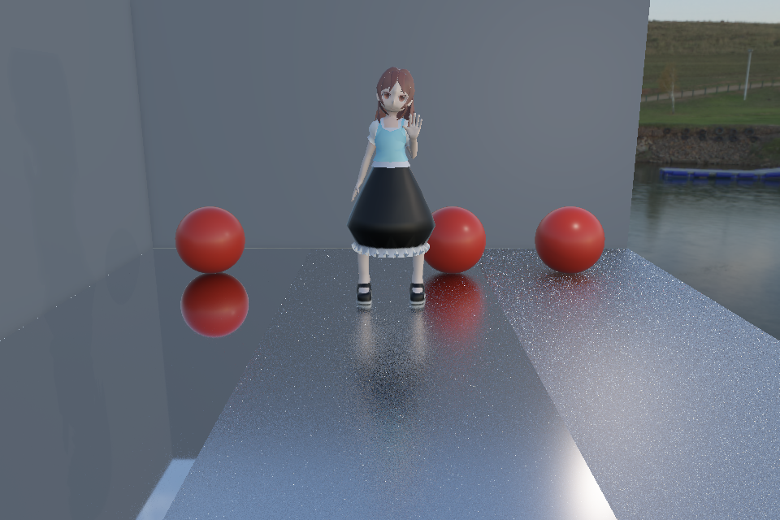
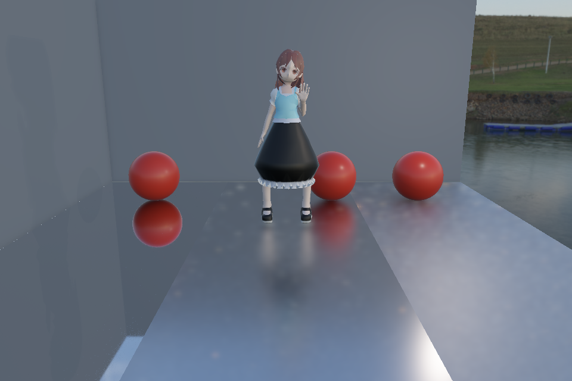

# Rendering notes

## Animated mirrors

The main camera rasterizes the scene. Mirror fragments launch inline Ray Query rays into a shared scene acceleration structure. A miss samples the environment; an ordinary hit evaluates surface shading; a mirror hit continues the path. The implementation stores at most three mirror styles and Fresnel weights, then resolves them from the inside out. Surface styles use hit normals, atlas colors and ray-shadow visibility. Outer styles filter the incoming linear radiance rather than lighting the source albedo again. Exposure and final tone mapping occur in the main composition.

Environment misses use a separate detail-preserving filter. Toon blends continuous luminance with soft bands; cool/warm filtering blends a luminance-normalized tint with the original image. The style-strength budget is shared across layers. F9 disables all style layers for a PBR comparison.

Each frame follows:

```text
GPU skinning + surface normals
  -> gather ray-triangle positions/normals/UVs
  -> BLAS update -> TLAS update
  -> shadow / normal-depth-motion prepass / AO
  -> forward shading + mirror queries -> animation panel
```

Compute-to-AS, BLAS-to-TLAS and AS-to-shader dependencies are explicit. Topology remains fixed during updates. The current implementation refits one combined BLAS, prioritizing correctness over separating static and dynamic update costs. Reflection shading supports the character's shared sRGB atlas at LOD 0; ray transparency uses a 0.5 alpha cutoff. Rough multi-bounce transport and independent local shading of intermediate mirrors are not implemented.

## Additional demos

Run these commands from the repository root:

```powershell
# Temporal AO inspection: T toggles history; F2 toggles the spatial filter
.\build\Release\VulkanRenderingLab.exe --ssao-blurred --ao-temporal on --ao-samples 8 --paused

# Multiple prototype groups: C toggles frustum culling; F8 toggles Hi-Z rejection
.\build\Release\VulkanRenderingLab.exe --mixed-scene --hiz-inspector --paused

# Frozen character pose with PBR mirror shading
.\build\Release\VulkanRenderingLab.exe --ray-query-scene --animated-scene assets/models/character/character.glb --animation Hello --animation-time .52 --mirror-styles off --paused
```

Temporal AO is opt-in. It uses motion reprojection and history rejection; half-resolution AO is reconstructed with geometry guidance. Screen-space AO cannot recover off-screen geometry.

Visibility culling compacts IDs into disjoint group partitions and updates indirect instance counts. Shadow draws retain the full instance ranges. Hi-Z uses explicit static occluders and conservative depth tests. Its cost and benefit depend on the workload; reduced instance counts alone do not establish a frame-time improvement.

## Evidence and diagnostics

- `tools/verify-mirror-styles.ps1`: fixed-pose style ON/OFF captures, animated-geometry checks, ray-query checks and synchronization validation.
- `tools/verify-ray-character.ps1`: playback, frozen poses, skinning modes, live controls, resizing, AO-resolution rebuilding and reflection toggling.
- `tools/verify-ssao-temporal.ps1`: temporal AO verification.
- `tools/benchmark-culling.ps1`: controlled visibility workloads; see [measurement conditions and results](benchmarks/README.md).

Nearest-intersection checks do not constitute a complete multi-bounce image reference. Nested reflections and artistic style composition also require visual inspection. GPU validation and CPU readbacks add overhead and must be separated from timing runs.

## Rough ray-traced reflections

The independent rough-reflection scene uses three panels of the same metal with
roughness 0.04, 0.27 and 0.55, from left to right. Identical red spheres make the
change in reflection spread easy to see. The animated character uses the same
dynamic acceleration structure path as the mirror showcase.

```powershell
.\build\Release\VulkanRenderingLab.exe --rough-reflection-scene --animated-scene assets/models/character/character.glb --animation Hello --paused
.\tools\verify-mirror-styles.ps1 -Rough
```

Each receiver defaults to eight GGX NDF half-vector samples using a stratified
sequence scrambled per pixel. Contributions include the single-scattering GGX
BRDF, correlated Smith masking, Schlick Fresnel and the reflection PDF. Rejected
directions contribute zero but remain in the total sample count. F11 compares
scene-ray reflection with the existing environment-only approximation. Receiver
Fresnel is already included in the rough output and is not multiplied again at
composition. The ideal/stylized mirror path retains its existing composition.
Spatial filtering and opt-in static temporal accumulation are available. Motion
reprojection and rough multi-bounce transport are not implemented.


For a preset that selects the Release executable, repository working directory,
ray reflections ON and composite view explicitly, use
` .\tools\run-rough-reflections.ps1 `.
The beginning of the window title shows `RQ ON/OFF`; F11 also prints the current
state to the console. This distinguishes a disabled reflection path from a
rendering fault when the long diagnostic title is truncated.


## Reflection spatial filtering

Rough reflections are traced into a full-resolution RGBA32F image before forward
composition. Depth and view normals come from the existing opaque prepass. This
demo reconstructs the three fixed floor receivers using their scene-space bounds,
and stores their exact roughness tag alongside radiance. This receiver lookup is
specific to this scene, not a general material G-buffer.

Three 5x5 a-trous passes use spacings 1, 2 and 4, weighted by receiver depth and
normal agreement. Neighbor tags must match, preventing cross-panel mixing. Invalid
pixels and the sharp panel are copied exactly. The filtered reflection is composed
after BRDF weighting and before exposure; the main character shading
is unchanged. This is a spatial approximation and can soften reflected details. An additional
reflection-hit guide moderates that smoothing, as described below.

Press **B** for raw/filtered composition; the title shows Spatial ON/OFF.
Use **F10** reflection-radiance view to inspect the selected result, and keep
**F11** ray reflections ON. --reflection-denoise off selects the raw image.
The trace and filter still execute in both modes to keep the comparison identical;
this switch does not measure the total cost of disabling the filter infrastructure.
Resize and AO-resolution rebuilds recreate resources and preserve the selection.

| Raw, 8 samples | Receiver-guided spatial result |
|---|---|
|  |  |

GPU timestamps report Reflection Trace and Reflection Spatial separately.
These intervals are not added together to substitute for the inclusive total.
tools/verify-reflection-spatial.ps1 checks finite values, exact receiver tags,
zero change on the sharp receiver, zero output outside receivers, reduced local
variation, animated geometry consistency, rebuilds and synchronization validation.
Verification-only image readbacks add overhead and are not performance data.
The checks do not establish ground-truth reflection quality or establish
the accuracy of the incoming scene-shading approximation.


## Reflection-hit-guided filtering

One additional deterministic, ideal-direction query records the reflected hit
normal and ray distance in RGBA32F; distance -1 identifies the environment and zero
identifies an invalid receiver. Alpha-aware candidate testing is shared with the
radiance queries. This is a stable proxy, not an average of the eight stochastic
radiance samples and not a complete description of the rough reflection lobe.

The spatial filter combines the receiver weights with reflected hit-distance,
hit-normal and geometry/environment similarity. Classification differences lower
weights rather than rejecting neighbors entirely. Guidance strength decreases with
roughness to avoid forcing a sharp ideal-ray silhouette onto a broad reflection.

Press **N** to compare hit-guided and receiver-only filtering, while **B** compares
filtered and raw reflections. --reflection-hit-guidance off fixes the receiver-only
comparison. Both modes generate the same raw radiance and guide queries, keeping
the sample budget unchanged. The selected state survives resource rebuilds.
The extra query is included in Reflection Trace timing; normal playback does not
read images back to the CPU.

Verification checks finite guide values, unit hit normals, geometry/environment
sentinels, zero guides outside receivers, sharp-panel invariance and the existing
spatial/ray checks. It does not measure ground-truth reflection error or establish
temporal stability. The ideal-direction proxy can misrepresent very rough lobes;
some detail loss and residual noise remain.

| Receiver guidance only | Receiver + reflection-hit guidance |
|---|---|
|  |  |


## Weighted reflection and finite-sample references

The rough receiver uses GGX NDF sampling (not visible-normal sampling), with
alpha = roughness squared. For a sampled half-vector h, the direction density is
D(h) (N dot h) / (4 V dot h). The sample contribution is incoming radiance times
BRDF times (N dot L), divided by that density. Cancelling D gives the stable
weight F * G2 * (V dot h) / ((N dot V) * (N dot h)). Samples below the hemisphere
are zero contributions; they must not be dropped from the denominator.

The model follows the [microfacet BRDF and reflection Jacobian in PBRT](https://www.pbr-book.org/4ed/Reflection_Models/Roughness_Using_Microfacet_Theory).
Here Fresnel uses the material's RGB F0 with Schlick, rather than complex conductor
IOR. Correlated Smith masking is evaluated directly for this indirect estimator;
the existing direct-light shader remains unchanged. No multiple-scattering energy
compensation or visible-normal sampling is implemented.

--reflection-samples accepts 1..256 (default 8). --reflection-reference fixes 256
samples, selects raw display with temporal accumulation off, freezes the light and camera sweep, and
freezes animated input at 0.52 seconds unless a pose was explicitly selected.
It is an offline inspection mode and can be slow; start at a small resolution.

    .\tools\run-rough-reflections.ps1 --reflection-reference --width 481 --height 321 --no-animation-panel
    .\tools\verify-reflection-brdf.ps1

The verification runner uses a fixed Hello pose, camera and light at 481x321.
It exports scene-linear HDR rather than measuring tone-mapped screenshots:
8-sample raw and filtered results and 64-sample raw are compared against the
same model at 256 samples on the two rougher receiver panels. The 256-sample
image is still noisy and uses the same approximate secondary-hit shading;
it is not full path-traced ground truth.

A local check on 2026-11-06 measured linear HDR RGB RMSE against that reference:

| Configuration | RMSE |
|---|---:|
| 8 samples, raw | 0.10514 |
| 8 samples, spatially filtered | 0.01541 |
| 64 samples, raw | 0.03082 |

These results describe this fixed scene and reference, not general filter quality
or GPU performance. Filtering can reduce variance while introducing detail bias.

Additional checks compare GPU unit-environment output against a CPU estimator,
including a grazing view, and compare final specular-only screenshots to one
HDR-to-exposure/sRGB composition (within one byte in the recorded run). This
detects duplicate receiver Fresnel. Portable tests independently integrate the
hemisphere to check importance weighting, furnace energy and the smooth F0 limit.
--reflection-furnace is diagnostic unit incoming radiance, not scene rendering.
--reflection-dump writes raw/filtered/temporal float32 RGBA plus JSON metadata and requires
--verify-ray-query. These readbacks are excluded from normal playback.


## Static temporal accumulation

    .\tools\run-rough-reflections.ps1 --animation-time .52 --reflection-temporal on
    .\tools\verify-reflection-temporal.ps1

Press **Q** to toggle accumulation; the title shows Accum ON/OFF and H, the
current history length. Keep **RQ ON** and **Spatial ON** to see the accumulated
result. **B** still shows the current raw frame when spatial composition is off.
The stage is opt-in. The launch script freezes the light; --animation-time freezes
the character. Playing the character or moving the camera intentionally resets
history rather than reprojecting it.

A submitted-frame phase scrambles the GGX sequence. The compute pass averages
scene-linear, BRDF-weighted samples **before** spatial filtering, with current
weight 1/(previous frames + 1). After 64 frames the weight stays at 1/64.
Sharp and invalid pixels pass through exactly. A CPU signature compares camera,
geometry pose and skinning modes, light and environment, and reflection settings
to the last submitted frame. A mismatch discards the whole history; stopping
allows accumulation to resume. Rebuilds preserve the toggle but not old pixels.
There is no motion reprojection or moving-history reuse.

The running mean and persistent history use separate RGBA32F images. A copy after
the compute dispatch updates history; barriers protect both the copy and spatial
reads. With accumulation off the stage copies the current frame through, keeping
command buffers and comparison inputs fixed. Reflection Temporal GPU timing
includes the dispatch, synchronization and history copy, even in passthrough mode.

In a fixed 481x321 Hello pose, compared on the two rougher panels with the same
finite 256-sample one-bounce reference:

| Configuration | Linear HDR RMSE | Mean luminance error |
|---|---:|---:|
| One 8-sample frame | 0.10514 | +0.397% |
| 32 frames of 8 samples | 0.02016 | -0.044% |
| 32 frames plus spatial filtering | 0.01308 | -0.070% |

This describes one fixed scene, not ground truth or a performance result. The
verification script checks the mean equation on GPU readback and tests camera,
animation, light, sampling/guide toggles, resize, AO-resolution rebuilds,
disabled mode, unit incoming radiance and the high-sample reference. Python and
NumPy analyze the final HDR buffers. Normal rendering does not read them back.

## Single-leg inverse kinematics

```powershell
.\tools\run-leg-ik.ps1
.\tools\run-leg-ik.ps1 --leg-ik right --animation-time 2
.\tools\verify-leg-ik.ps1
```

This isolated rig experiment uses the character's Idle pose at time zero. A
four-second procedural sole target drives an analytic two-bone solver. Enter
pauses the target, Y compares IK with the unchanged base pose, and the playback
panel controls target time and speed. The yellow cross marks the requested sole
position; the ring marks the actual sole proxy. Lines show the hip/knee/ankle
chain, ankle-to-sole offset, clearance above the fitted ground and knee bend
direction. These diagnostic lines are visible through geometry. The title shows
STANCE or SWING.

The cycle holds the rear contact for 0-1 seconds, swings forward during 1-2,
holds the front contact during 2-3, then swings back during 3-4. Horizontal travel
uses quintic smoothstep; a quartic lift arc has zero velocity at both ends.
Each support interval fixes the target in rig-world space. This placement drill
returns to its start without sliding the foot along the ground.

At initialization, vertices with at least 99.9% weight in the selected foot
subtree calibrate a sole proxy. The lowest points define its height and an
averaged horizontal location. Morph offsets in the base pose are included.
The sole offset is stored in foot-local space; preserving base foot orientation
allows sole targets to be converted into ankle targets. The ground is a fixed
plane at the initial sole height. The IK demo translates the entire character
vertically so this plane coincides with the horizontal scene floor at y=0.
This calibration does not query terrain or detect collisions with scene meshes.

The solver preserves segment lengths and clamps unreachable targets. A pole
direction selects the knee bend plane, blending from the authored rest bend
toward the toe direction during the lift. World-space pivot rotations update
each joint subtree; rebuilding mesh-local joint palettes feeds the existing GPU
skinning, prepass and ray-geometry update paths. Foot orientation stays at its
base orientation. Original model and animation assets are unchanged.

This is a single-leg target-following prototype, not a walking controller. It
currently expects the character's UpperLeg.L/LowerLeg.L/Foot.L/Toes.L naming
(or .R), a direct leg chain, positive uniform chain scale, and Y-up rig space.
There is no terrain collision, pelvis balance, full gait generation or cloth collision;
the skirt follows existing skin weights and can deform or intersect the leg.
The tests check reachable and clamped targets, both real leg chains, unchanged
unrelated nodes, foot orientation, palette consistency, planted contacts and
phase-boundary continuity. Twelve GPU cases cover support/swing poses,
linear/dual-quaternion skinning, playback, IK toggles, resize and mirrors.

## Bilateral stepping in place

```powershell
.\tools\run-procedural-gait.ps1
.\tools\run-procedural-gait.ps1 --animation-time 1.1
.\tools\run-procedural-gait.ps1 --ray-query-scene
.\tools\verify-procedural-gait.ps1
```

`--leg-ik both` extends the same solver to both legs. Their swing windows are
offset by half a four-second cycle, with double-support intervals between them.
Each swing follows a smooth lift-and-return arc; support targets remain anchored
in rig-world space. The character marches in place without forward root motion.

The pelvis subtree receives a small lateral shift toward the supporting leg and
a downward offset for reach margin. Both leg solves then operate on that shared
pose before a single palette refresh. This is a bounded kinematic heuristic,
not a center-of-mass or dynamics solver. Foot orientation stays fixed; no heel
strike, toe-off, terrain detection or cloth collision is modeled. A small
contralateral arm swing, elbow flex and torso lean/twist now accompany the gait.
Both legs must share a pelvis parent and approximately level base soles.

The overlay shows both chains, sole targets and actual contact proxies, plus a
pelvis-to-ground line and the pelvis displacement. Y restores the original pose,
including the pelvis; Enter and the panel control the shared gait clock. Seek
and resource rebuilds evaluate the pose from absolute time without accumulating
state. The original single-leg modes are still available.

CPU tests sample 401 bilateral poses and check fixed support anchors, segment
lengths, foot clearance, support-side pelvis motion, phase continuity, palettes,
repeatable seeking and disabled mode. Eight GPU cases exercise double support,
both swing sides, linear skinning, the IK toggle, resize, ray mirrors and 80
frames of continuous playback with synchronization validation.

## Forward walking

```powershell
.\tools\run-procedural-walk.ps1
.\tools\run-procedural-walk.ps1 --animation-time 4.8
.\tools\run-procedural-walk.ps1 --ray-query-scene
.\tools\verify-procedural-walk.ps1
```

`--leg-ik walk` adds a finite eight-second forward path, roughly 0.96 rig units
for the supplied character. The path eases in and out and stops at its endpoint;
playback defaults to non-looping. Restart or seeking explicitly repositions the
character. Enabling loop intentionally returns to the start and clears motion
history. Playback speed scales both root translation and stepping together.

Four gait cycles are derived from accumulated path distance, rather than an
independent timer. Each foot advances one stride during its swing window using
quintic interpolation. Its support anchor stays fixed in rig-world space while
the body moves past it. At the end both feet have advanced the full path length.
Root translation updates all node world matrices, then pelvis adjustment and
the two leg solves produce the final pose and mesh-local palettes. The fixed
foot orientation makes this a short-step kinematic prototype, without heel/toe
roll, turning, terrain planning or dynamic balance. The procedural upper-body
layer now supplies arm swing, elbow flex and torso lean/twist.

Y disables leg/pelvis correction while retaining forward root motion, exposing
the sliding FK comparison. Enter pauses the shared clock. The path and anchors
are deterministic functions of time, so seeking and window rebuilds do not need
to replay earlier frames. The existing march and single-leg modes are unchanged.

801 CPU samples check forward progress, fixed support contacts, reach and bone
lengths, palette consistency, endpoint hold and repeatable seeking. Ten GPU cases
exercise start/swing/end poses, linear skinning, IK comparison, resize, mirrors,
stop/restart/speed/seek/loop controls and 160 continuous frames. Cloth can still
deform or intersect the legs under the original weights.

## Arrow-key character control

```powershell
.\tools\run-character-controller.ps1
.\tools\run-character-controller.ps1 --ray-query-scene
.\tools\verify-character-controller.ps1
```

The live controller (`--leg-ik control`) uses camera-relative arrow-key input.
The character accelerates toward its facing direction and turns gradually toward
the requested direction. Releasing the keys decelerates the body, finishes the
current step and replants the feet before settling to idle. Diagonal input is
normalized. Enter pauses/resumes, Home resets the full controller, F12 toggles
bone/contact diagnostics, and Y compares IK with the moving base pose.

The F12 overlay shows the complete skin-joint hierarchy, including torso, head,
arms, fingers, legs and the supplied face/hair/skirt chains. It follows the
final deformed pose and keeps the sole-target markers. Zero-length links are
omitted. `--show-bones` enables it on launch; the overlay remains visible through
the character without writing scene depth.

The clip timeline is replaced by a posture panel in this mode; arrows retain
timeline seeking in the
older animation demos. The camera follows the character while retaining orbit
controls. Movement is bounded to a two-unit square radius in rig-world X/Z;
this demo has no obstacle collision or terrain support.

Each foot stores a world-space support anchor, swing start/goal and facing angle.
Only one foot swings at a time. A step predicts a landing point from current
speed and turn rate, then interpolates both its contact and yaw. The other foot
keeps its position and orientation while the torso turns. The pelvis lowers as
needed for reach, within a bounded range. A spine/chest layer adds lean and
counter-rotation; the arms swing opposite the active leg with slight elbow flex.
Its weight decays to idle rather than freezing an arm mid-swing.

Controller updates use substeps no longer than 1/120 second and clamp long stalls
to 0.1 second. The complete CPU state, including in-flight foot targets, survives
swapchain rebuilds. GPU skinning, previous-frame vertices, shadows, prepass and
ray-geometry updates consume the resulting shared pose. This is a kinematic
controller with calibrated shoe support proxies, not a physical character or cloth solver.
The imported model, weights and animation files are unchanged.

Interactive poses have no clip time. Rough-reflection history therefore uses a
pose revision that changes only when final node matrices change, including the
arm-settling phase after root motion stops. A fully paused pose may accumulate;
resuming or changing the IK comparison invalidates the old history.

CPU checks cover 1,200 moving/turning/stopping frames, planted contacts, restart,
mid-step rebuilds, upper-body motion and 30/60/120 FPS movement consistency.
GPU checks use scripted directional input to exercise pause/resume, turning,
release-to-idle, resize, linear skinning, ray mirrors and rough-reflection history
with sync validation.

## Live posture and support constraints

The character controller now opens a posture panel. Pause during a step with
Enter or PLAY/PAUSE, then drag pelvis drop, support-side shift, body lean, knee
forward bias, stance width, arm swing or elbow bend. F8 hides the panel and F12
shows contact/bone diagnostics. The camera reserves space for the panel without
changing the projection model. DEFAULT restores parameter defaults; POSE ON/BASE
compares the stored tuning with default parameters at the same controller state.

Pelvis drop and support shift are fractions of leg length; lean and arm/elbow
settings are degrees. Knee bias blends the authored knee plane toward forward.
Width scales future landing targets during motion, preserving planted anchors
and the current swing goal. At idle, editing width immediately previews both
feet. STAND / APPLY WIDTH pauses, cancels the current step and refits both feet
at the current root position and heading. Other pose edits apply while paused.

AUTO keeps the pelvis reach adjustment enabled; MANUAL removes that adjustment
for comparison. The analytic leg solver still preserves bone lengths and clamps
unreachable targets. The panel reports actual contact-target error, each requested
ankle distance divided by total leg length, signed automatic pelvis height
correction (AUTO Y), and actual knee flexion in degrees (zero is straight).
LIMIT warns when the target was clamped. This is pelvis/support tuning, not a
mass-based center-of-gravity or dynamic balance model. Existing cloth limits
still apply.

SAVE writes a versioned, validated parameter file to `build/character-pose.cfg`;
LOAD explicitly restores it in a later session. Version 3 adds standing hip and
torso offsets; versions 1/2 remain readable with defaults for missing fields.
Explicit values in old profiles, including a wide stance, are retained. Loading validates the entire
file before replacing live settings. Default/baseline comparison, panel state
and custom settings survive swapchain rebuilds along with controller foot state.
The model and authored clip data remain unchanged.

```powershell
.\tools\run-character-controller.ps1
.\tools\verify-posture-panel.ps1
```

CPU tests cover slider bounds, input capture, config roundtrips and invalid data,
plus paused edits with fixed foot targets and 360 frames of tuned locomotion.
Three GPU cases exercise the same pointer hit-testing path for all controls,
pause/resume, compare/default actions, config save/load, resize, ray mirrors and
rough-reflection history invalidation after actual pose changes.

## Heel strike and toe-off

The live controller adds HEEL STRIKE and TOE OFF angle sliders (degrees), plus
ROLL TIME (seconds per transition). A step rolls around its planted toe proxy,
swings through the air, lands on its heel proxy and eases to flat support. The
panel labels each foot TOE, AIR, HEEL or FLAT. Set ROLL TIME to zero for the old
flat-foot comparison. Legacy absolute-time leg/march/walk demos retain their
earlier contact model.

Heel and toe proxies are conservative support edges on the calibrated sole
plane, enclosing rigid shoe vertices along the inferred foot-forward direction.
They are not pressure contacts from a physical collision solver. Foot rotation
updates the ankle target as contact minus rotated pivot-to-ankle offset, then
the two-bone solver preserves leg lengths. Swing endpoints are the actual rolled
sole positions, so changing pivot representations does not teleport the ankle.
Yaw changes only in the swing. The whole foot subtree rotates rigidly; separate
toe-joint flex is not modeled.

Default transitions add 0.06 seconds on each side of the existing 0.38-second
airborne swing. The planner alternates legs and finishes support transitions
before settling to idle. Progress and targets survive pause/rebuilds. Frozen
edits change the preview and clear motion history as before. F12 retains the
active pivot marker and adds a heel-to-toe proxy segment.

CPU verification samples 661 extreme-angle poses, checks rigid shoe clearance,
fixed toe/heel pivots, continuous phase boundaries, zero-time disable and legacy
config loading. GPU controller checks cover all phases during turning/stopping,
previous-frame skinning, prepass, resize, mirrors and reflection history; panel
checks exercise editing and saving/loading all three new fields.

## Imported rest-pose correction

The controller's default stance width is now 50% of the supplied model's
imported 0.636-unit contact separation, with a 30-115% editing range. Knee bias
defaults to 90% forward and extra walking lean to zero. At initialization, the
pelvis projection aligns with the shoe-proxy midpoint and the head-to-hip axis
is corrected toward vertical (about 3 degrees for this character). The imported
bind pose, inverse-bind matrices, weights and authored clips remain unchanged.

HIP FORE AFT adds a permanent facing-relative pelvis offset as a fraction of leg
length; negative moves backward. REST TILT adds a static upper-body angle around
the hips; negative tilts backward. Both work at idle, separately from the
activity-weighted BODY LEAN. Leg IK keeps the existing foot targets fixed when
the torso or pelvis changes. These are geometric pose corrections, not a mass
distribution or dynamic balance calculation.

Default PELVIS DROP is zero. AUTO uses 99.8% leg reach at rest and blends toward
99.2% during locomotion, rather than the older 97.5% cap. The neutral idle height
may raise or lower the pelvis so narrowing an imported bent-leg pose does not
leave it crouching. The supplied character stands with about 7.3 degrees of knee
flexion after STAND, retaining margin from the full-extension singularity.
Positive AUTO Y means upward correction; negative means lowering. An older
profile with a nonzero drop retains that deliberate crouch until DEFAULT.

Use DEFAULT, then STAND / APPLY WIDTH to preview the corrected standing pose.
The stand action keeps world position and heading, resets velocity and arm blend,
and replants both feet using current parameters. SAVE/LOAD preserves the twelve
version-3 fields. Loading an older explicit 100% width restores that value;
DEFAULT selects the new narrower preset. Tests cover neutral alignment, idle
width edits, static offsets, mid-step standing, rebuilds and mirrored geometry.
